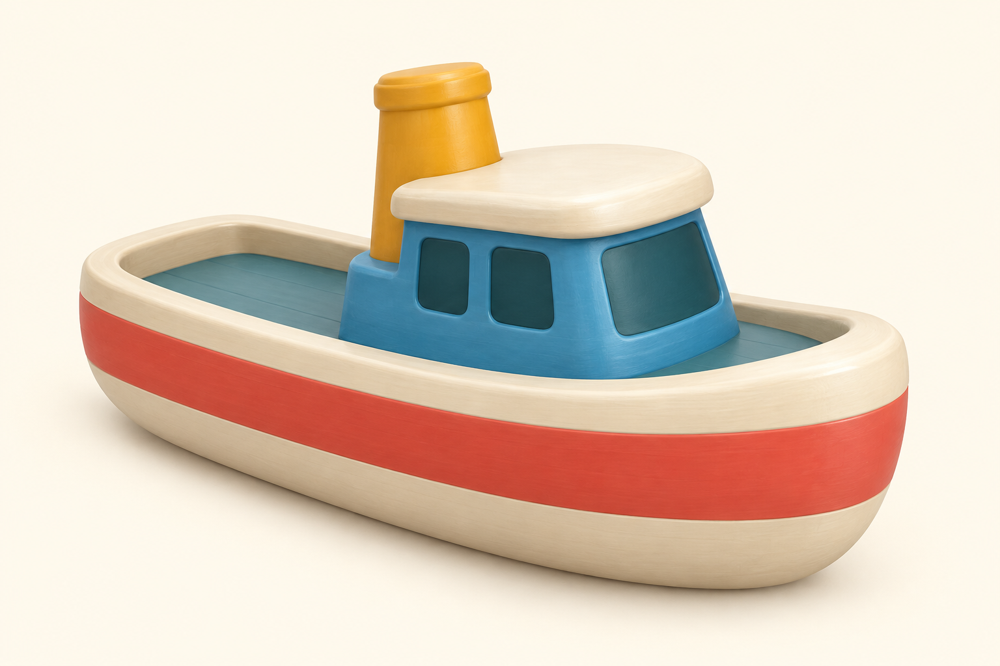

# Лодка для разводного моста — референс

m0135, третий приоритет после зданий и людей. [Референс](boat-v1.png) — компактный игрушечный буксир: кремовый корпус, коралловая полоса, синяя рубка и короткая жёлтая труба. Стиль визуально сопоставлен с принятым car-v1; отдельного заказа 3D пока нет. Один встроенный Image-вызов, без Tripo/Higgsfield/API расходов. Полный промпт и SHA — [reference.json](reference.json).

В [contract.json](contract.json) записаны текущие размеры/движение и условия будущей проверки. В коде уже есть `boat` в preload и замена stand-in через model(): fit по X=3, нос предлагаем нормализовать по+X; yaw−π/2 направит его по маршруту+Z. Путь (37,−10)→(37,19), ширина канала3.2. Маршрут, мост и задача сохраняются.

Целевой полный габарит после fit — не больше3×1.5×1.3(X/Y/Z), с трубой; это ограничение проекта, не замер изображения. Бюджет4ktri/1материал/512WebP/до200KB. Корпус цельный, без подставки, прозрачных окон, воды и мелких висящих частей. Для существующего движения лодки скелет не требуется.

Особенно проверить реальную модель при самом раннем разрешённом проходе моста `up>0.85`: пролёт поворачивается на up×1.15, а лодка покачивается и меняет Y. Данные габаритов/шарнира ещё не доказывают отсутствие пересечения. После GLB обязательны замеры и прохождение мостового задания, включая положение на воде и направления носа. На стадии референса новой игровой/mobile/FPS/iPad проверки нет. Runtime/public не менялись.
