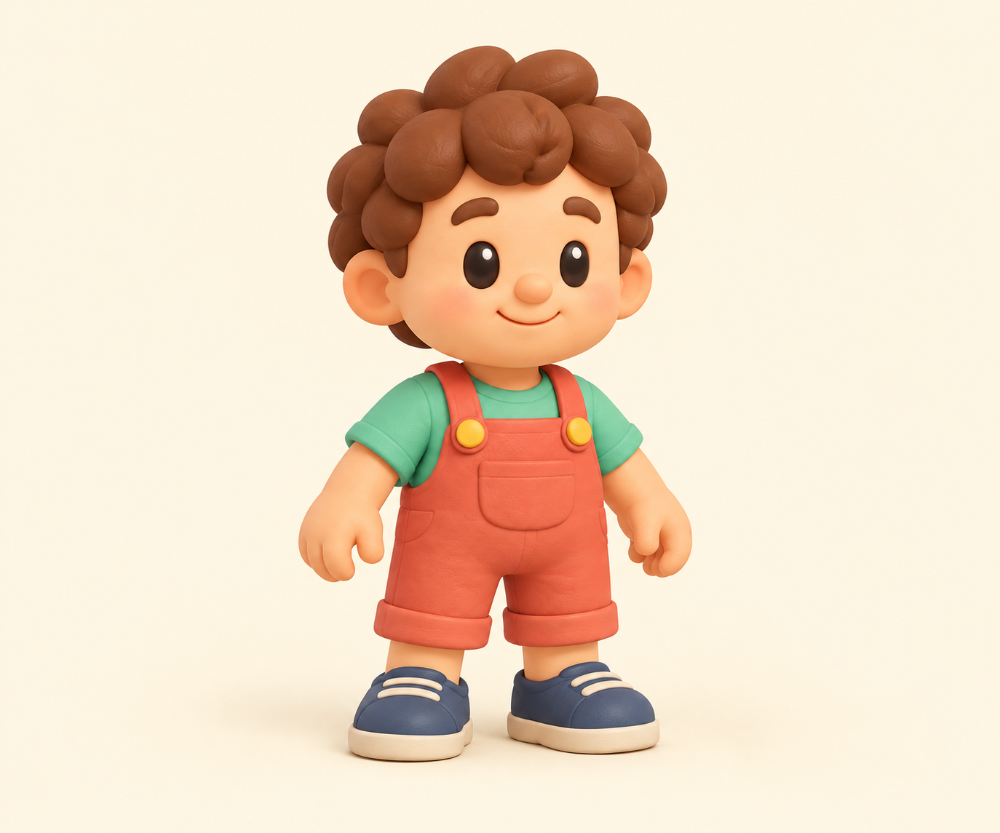

# Ребёнок для города — отдельный референс

Продолжение согласованного списка m0135, персонаж из принятого листа m0103. Один встроенный Image-вызов выделил мальчика в коралловом комбинезоне и мятной футболке; сохранены лицо, кудри, палитра и игрушечные пропорции. Поза подготовлена для будущей анимации: руки отделены от корпуса, ноги разделены, фигура целиком, без подставки и предметов. Изображение просмотрено; перечисленные условия соблюдены.

Полный промпт, исходный/выходной SHA и способ генерации — [reference.json](reference.json). Семь точных размещений, fit1.15/1.2, бюджет и условия проверки — [contract.json](contract.json). Это референс, GLB ещё не сделан. Tripo/Higgsfield/API расходов на этот шаг нет.

Один `child.glb` уже предусмотрен загрузчиком для child…child7. Claude принял образ и контракт в m0364: статичный GLB, без рига/раздельных конечностей, фронт+X и низY0. В609e891 дети при входе в школу поворачиваются к двери и скачут вприпрыжку; остальные реакции — bob/hop/spin/flip целой фигуры. Ходьба ногами и покупные анимации не входят в принятый контракт. После GLB проверить этот код с реальным силуэтом ребёнка.

Игровые файлы, координаты и модели не менялись. На этом шаге — проверка изображения, метаданных и контракта по исходникам; новой мобильной проверки игры нет. После GLB обязательны реальные габариты, семь инстансов, школьный путь/прыжки, касания и соседние клеммы. Общий вопрос стоимости новой 3D-геометрии/рига следует проверить по ранее данному разрешению владельца до запуска заказа.
