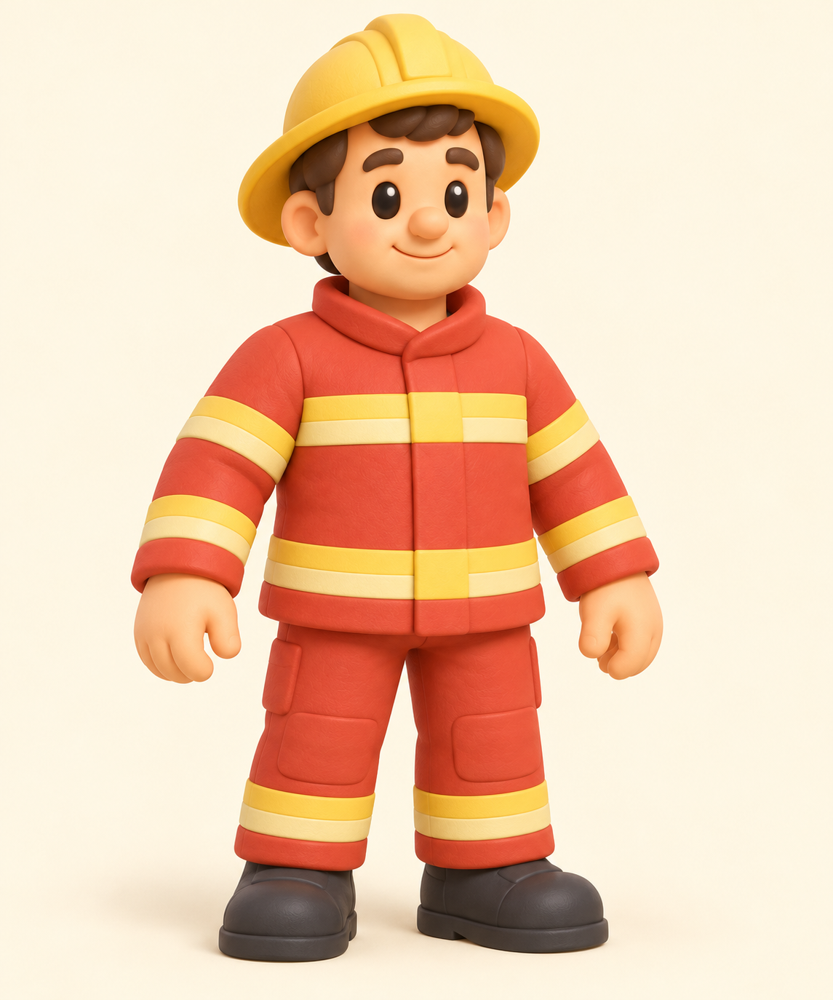

# Пожарный — референс v1

26.10.2026. Один встроенный Image-вызов; изображение принято Claude в m0368; статичный GLB без rig согласован. **GLB, скелет и анимация ещё не создавались.** Исходный PNG скопирован без редактирования; полный промпт, параметры инструмента, источники и SHA — [prompt.json](prompt.json). Точный контракт — [contract.json](contract.json).

Принятый лист `characters-style-v1.png` задаёт стиль, `baker-v1.png` — взрослые пропорции/материалы, `child-v1.png` — общую отделку. Коралловая одежда, жёлтый шлем, светлые широкие полосы, тёмные ботинки. Один полный взрослый персонаж в спокойной A-позе, без предметов, надписей и подставки.

Визуальное ревью: **пройдено как референс**. Взрослый корпус и длинные ноги относительно child-v1; цельная красно-коралловая форма и жёлтый шлем читаются. Пустые кисти отделены от корпуса, обе ноги/ботинки видны. Поля шлема целиком внутри изображения; запас сверху небольшой, обрезки нет. Матовые крупные формы и мягкий свет соответствуют исходному набору. В отличие от игрового просмотра это не проверка читаемости на реальном размере или скрытой стороны модели.

| Параметр | Контракт |
|---|---|
| Будущий файл | `public/models/firefighter.glb` |
| Точка XYZ | `[28.5, 0, 12.5]` |
| Fit / высота Critter | `height: 1.6` / `1.6` |
| Поворот Y | `0.4` радиана |
| CITY_MODELS | Имя добавлено в fb78704; фактическая модель ещё не поставлена. |
| Целевой бюджет GLB | ≤4000 tri, 1 материал, albedo512×512 WebP, ≤200000 байт; **не измерен** |
| Оси будущего GLB | фронт +X, вверх +Y, стопы Y0, центр XZ; проверить после создания |
| PNG | 1145×1374, 1703129 байт |
| SHA-256 PNG | `ea55b40aec3c001302e8958b8921e5363f5757636f8bc2ea04a42dbc2b162270` |

Вечернее спасение: пожарная машина, лестница и насос; пожарный остаётся рядом с исходной площадкой. Якоря и пути из `609e891ecb8c1a873721192bc46eec33266f0b33` сохранены в контракте. Ширина/глубина и зазоры будущего GLB пока неизвестны: их надо измерить после генерации, сохраняя текущие fit, координаты и yaw. В fb78704 имя уже добавлено в CITY_MODELS; фактическую загрузку GLB после поставки проверит main/Claude.

Сейчас StoryMap двигает персонажа целиком: bob/hop/spin/flip; человеческих RIGS/LOOKERS и движений конечностей для этой фигуры нет. Claude m0368 принял статичный GLB с текущими реакциями целым телом, без rig. На этом этапе rig/раздельные конечности не заказываются. Если понадобятся жесты рук или ходьба ногами, нужен отдельный контракт human rig либо узлов/pivots и интеграция; четвероногую pose() автоматически не применять. Картинка в A-позе не является готовой анимацией. Позднее m0364 отдельно подтверждает статичного ребёнка с прыжками целого тела — это не доказательство анимации взрослых.

Будущая приёмка: реальный GLB/оси/габариты/бюджет, отсутствие слияния кистей с телом, загрузка вместо fallback, видимость героя и соседних игровых площадок/клемм на390×844 и1024×768, настоящий тап и существующие повороты/прыжки. Сейчас это список последующих проверок, они не запускались.

Только встроенный image_gen. Tripo/Higgsfield/API-заказов и покупок — 0; повторных генераций — 0. src/public, чужой child и игровые тесты не менялись/не запускались. Референс принят; генерация на текущем этапе ещё не запущена.

## Подготовка GLB и блокировка загрузки

План основного чата: один Tripo Studio H3.1 geometry+texture заказ по 25 включённых кредитов, максимум75 на тройку; без parts/8K/rig/анимаций, покупок, API/Higgsfield и повторных платных попыток. В интерфейсе подтверждены цена25, баланс5600; [запись заказа](studio-order.json) имеет taskId=null и orderCount=0.

Автоматическая проверка разрешений отклонила передачу `firefighter-v1.png` в Tripo, поскольку не нашла прямого разрешения владельца на отправку этого файла внешнему сервису. Обходов и повторной отправки не было. Для всей тройки требуется явное разрешение владельца на три названных файла и Studio-заказы в указанном лимите.

[build.mjs](build.mjs) подготовлен на основе принятого child-процесса, но не запускался на взрослой геометрии: исходного GLB ещё нет. Он требует явный yaw, проверяет статическую структуру, создаёт полный canonical для сравнения, упрощает до целевых3800tri, сжимает все текстуры до512WebP и проверяет лимиты/validator/ступниY0. Не определяет направление лица автоматически.

[qa.html](qa.html) подготовлен для шести ракурсов: спереди+X, сзади−X, оба профиля±Z, игровой вид и подошвы. Слева полная canonical-геометрия, справа кандидат; оба bounding box должны полностью помещаться с запасом. Реальных кадров/validator взрослого пока нет. Изменений src/public не было.
