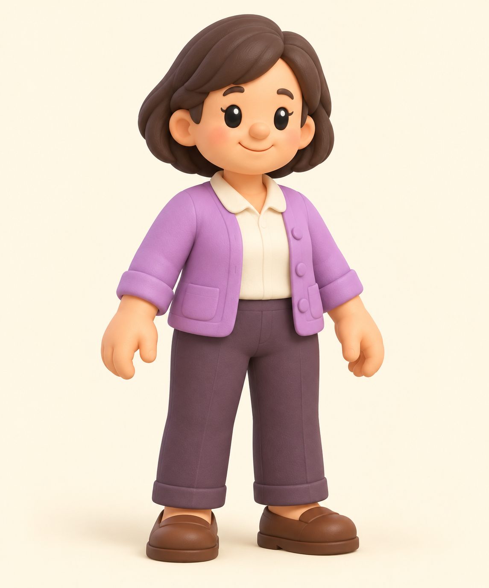

# Продавец — референс v1

26.10.2026. Один встроенный Image-вызов; изображение готово к ревью основного чата/Claude. **GLB, скелет и анимация ещё не создавались.** Исходный PNG скопирован без редактирования; полный промпт, параметры инструмента, источники и SHA — [prompt.json](prompt.json). Точный контракт — [contract.json](contract.json).

Принятый лист `characters-style-v1.png` задаёт стиль, `baker-v1.png` — взрослые пропорции/материалы, `child-v1.png` — общую отделку. Лавандовый кардиган, кремовая блуза, приглушённые сливовые брюки, коричневая обувь. Один полный взрослый персонаж в спокойной A-позе, без предметов, надписей и подставки.

Визуальное ревью: **пройдено как референс**. Взрослая женщина с короткой объёмной стрижкой, взрослые пропорции торса/ног; отделка совпадает с baker/child. Руки пустые, просветы у корпуса и между ног видны. Пуговицы/карманы присоединены к одежде, отдельного реквизита нет. Матовые крупные формы и мягкий свет соответствуют исходному набору. В отличие от игрового просмотра это не проверка читаемости на реальном размере или скрытой стороны модели.

| Параметр | Контракт |
|---|---|
| Будущий файл | `public/models/shopkeeper.glb` |
| Точка XYZ | `[47.5, 0, -19]` |
| Fit / высота Critter | `height: 1.6` / `1.6` |
| Поворот Y | `0` радиана |
| CITY_MODELS | Имени пока нет; при интеграции добавить в список загрузки. |
| Целевой бюджет GLB | ≤4000 tri, 1 материал, albedo512×512 WebP, ≤200000 байт; **не измерен** |
| Оси будущего GLB | фронт +X, вверх +Y, стопы Y0, центр XZ; проверить после создания |
| PNG | 1145×1374, 1633813 байт |
| SHA-256 PNG | `b948b92e27b252a4667b587137cb0d29b5607d834c37b8843c9ff13577b8a9bb` |

Ночная тревога у магазина: енот, домино и звонок; продавец стоит у магазина. Якоря и пути из `609e891ecb8c1a873721192bc46eec33266f0b33` сохранены в контракте. Ширина/глубина и зазоры будущего GLB пока неизвестны: их надо измерить после генерации, сохраняя текущие fit, координаты и yaw. Один файл в public не исправит отсутствие preload. Claude в m0364 подтвердил, что добавит это имя в CITY_MODELS при поставке GLB.

Сейчас StoryMap двигает персонажа целиком: bob/hop/spin/flip; человеческих RIGS/LOOKERS и движений конечностей для этой фигуры нет. Статичный GLB с текущими реакциями — предлагаемый вариант; окончательный контракт анимации взрослых у Claude. На этом этапе rig/раздельные конечности не заказываются. Если понадобятся жесты рук или ходьба ногами, нужен отдельный контракт human rig либо узлов/pivots и интеграция; четвероногую pose() автоматически не применять. Картинка в A-позе не является готовой анимацией. Позднее m0364 отдельно подтверждает статичного ребёнка с прыжками целого тела — это не доказательство анимации взрослых.

Будущая приёмка: реальный GLB/оси/габариты/бюджет, отсутствие слияния кистей с телом, загрузка вместо fallback, видимость героя и соседних игровых площадок/клемм на390×844 и1024×768, настоящий тап и существующие повороты/прыжки. Сейчас это список последующих проверок, они не запускались.

Только встроенный image_gen. Tripo/Higgsfield/API-заказов и покупок — 0; повторных генераций — 0. src/public, чужой child и игровые тесты не менялись/не запускались. Основной чат передаёт референс на ревью; платная генерация этим файлом не выполняется.
