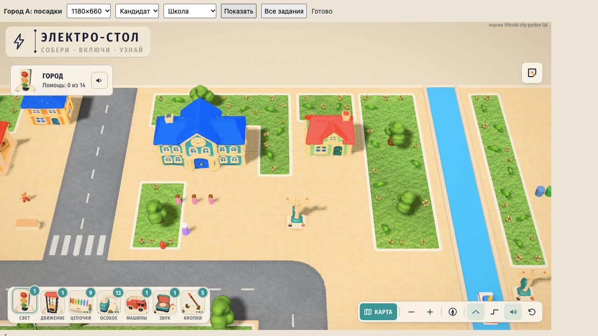

# Город A — посадки на новых газонах

26.10.2026. По m0314 добавлены9 небольших дубов высотой около2.8,82 низких куста и182 цветочные группы на31 новый защищённый газон. Все14 прежних групп DECOR и пять массивов земли/дорог/оград сохранены. Новых моделей и текстур нет; используются tree-oak-lite, bush-lite и flower-cluster. Это первый проход посадок, не утверждение полного совпадения с концептом A.

`build.mjs` воспроизводит кандидат из baseline.json. Полные GLB-границы после fit/scale/yaw должны помещаться в газон с отступом, не пересекать существующий декор и107 защищённых прямоугольников из ../lawns.json. Посадки обходят дороги, входы, площадки, столбы, маршруты, канал и гавань. Скамейки без GLB находятся только в старом парке; новые посадки туда не добавляются. Одна цветочная группа возле школьного персонажа была исключена штатным dressing(), её удалили из авторинга. Все273 оставшихся экземпляра реально принимаются игрой.

`prepare-snapshot.py` создаёт изолированную копию исходников; `review.html` и `qa-runtime.js` переключают исходную и новую instanced-группы в одной реальной сцене. Runtime-исходники не изменяются. Оригинальная группа определяется структурно и обязана быть единственной; внутри неё старая кодовая ограда содержит обычные Mesh, это учтено. Базовый снимок1f9cc84; SHA-256 и соответствие применённых числовых данных — snapshot.json и verification.json. Заключительное форматирование TS не меняет проверенный payload.

Проверены все14 игровых ракурсов на1180×660,390×844 и1024×768. В каждом —30 клемм по5 точек и31 рабочий круг по12 точек:522луча,7308 на размер,21924 всего. Новых перекрытий нет. Сохранены и крупные кадры школы/юга/запада. Скриншоты оболочки1280×720: нижний интерфейс iframe390×844 и1024×768 выходит за кадр; числовой аудит использует полный размер iframe. Это проверка новых посадок с настоящей перспективной камеры, не всех прежних объектов и не произвольной камеры игрока.

В группе городского декора32→52 InstancedMesh-пакета,128352→376119треугольников (добавлено247767 до отсечения камерой и теневых проходов). Это не FPS и не renderer.info всего кадра. Цветы без теней по штатному правилу. Плавность/iPad/q2/PWA остаются за интеграционной проверкой Claude.

Финальные отчёты: ошибки страницы[], contextLost=false. При отладке QA был исправлен поиск группы ограды; дополнительно IAB записывал MutationObserver.observe TypeError без URL, который не попал в обработчики ошибок страницы. Его источник не установлен. Общего отказа WebGL в финальном прогоне нет.

Проверки: npm test —21/21, npm run typecheck —pass; node assets-src/design-pass/city-materials/garden/verify.mjs —pass. verify.mjs также сравнивает исходные runtime-хэши и неизменность прежних данных; использованный временный снимок требуется для повторной сверки числового payload (его путь сохранён).

Для визуального воспроизведения запустить prepare-snapshot.py, в полученной папке `./node_modules/.bin/vite --config qa-vite.config.mjs`, открыть локальный5195/qa.html. Генератор выдаёт candidate.ts, но не подменяет src автоматически. Основная игра использует только добавленные записи src/city-decor.ts.
