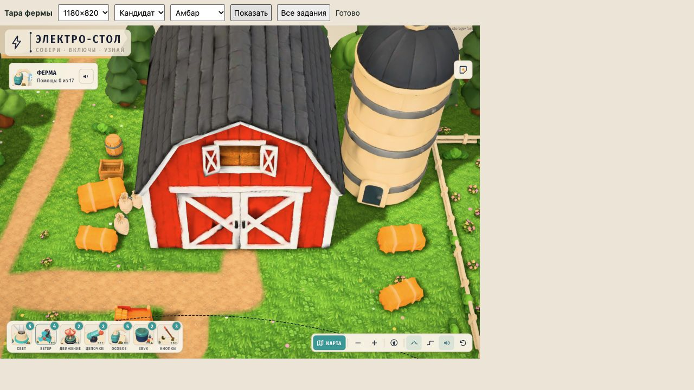
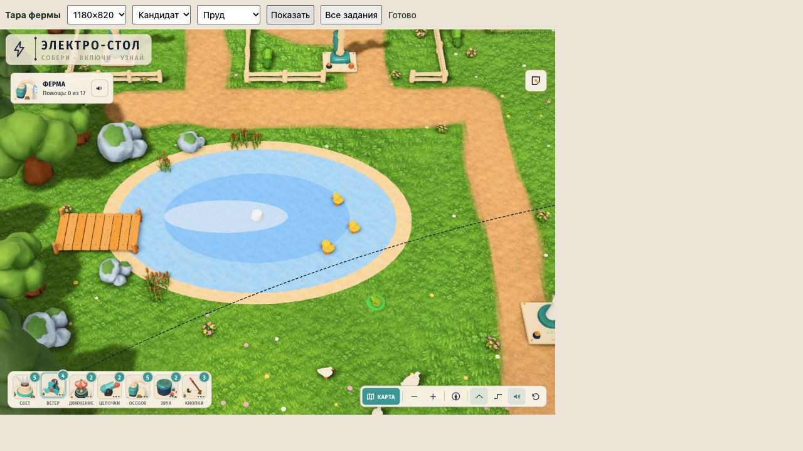

# Тара, заметный камыш и второй лесной ряд

Подключены два ящика и две бочки у боковых стен амбара и сарая. Семь пучков камыша высотой1,3 заменили прежние три высотой0,85: три на северном берегу, три на юго-западном и один у северо-западного камня. Восточный берег и проход к насосу свободны. Из принятого `farm-v3/forest-pass-2/additions.json` добавлены20дубов,10елей и3куста.

В сцене **645→686 экземпляров**. Все642прежних экземпляра, кроме уточнённого камыша, сохранены в исходном порядке; дороги, ограды, грунт, грядки, луга и пруд сохранены побайтно как данные. Исправление мыши из967497a входит в проверенный снимок. Общая логика игры не изменена.



## Модели

| Модель | Размер файла | Треугольники | Fit | Экземпляры |
|---|---:|---:|---|---:|
| farm-crate | 21 120 B | 2 892 | width1,35 | 2 |
| farm-barrel | 22 076 B | 1 336 | height1,3 | 2 |

Оригинальная локальная геометрия, цвета вершин, один материал на модель, без текстур и внешних генераций. Ящик имеет дощатое дно, стенки с прорезями и угловые стойки. Бочка —14выпуклых клёпок, крышку и два обруча по профилю корпуса. ОсьY вверх, основание после штатного fit наY0. Meshopt; glTF-validator0ошибок/0предупреждений. Декодированные вершины/нормали конечны; хеши, исходные границы и информация валидатора — `models.json`.



## Проверка общей сцены

Изолированный git-archive967497a, с кандидатами только в данных фермы и двух новых GLB. Public скопирован из закреплённого коммита, поэтому параллельные изменения не влияют на QA. Используются настоящие `model()`, `dressing()` и `Stage.render()`; отдельная невидимая группа всех44новых/уточнённых экземпляров нужна только для raycast.

- Все44экземпляра проходят штатный фильтр размещения: 4тары,7камышей,33лесных.
- Полные повёрнутые границы11экземпляров тары/камыша не пересекают старые строения, декор, новый лес и авторские рабочие площадки. Пучки камыша внутри двух групп намеренно перекрываются друг с другом.
- Минимальный зазор новых границ до края дороги1,116, до оград с запасом0,15 —3,966. Маршрут уток проверен в360точках с резервом радиуса тела0,75: минимальный остаток0,357.
- На1180×820,390×844 и1024×768 проверены17реальных игровых камер через `StoryMap.view(need)`, включая ближайший источник питания. Всего51ракурс,93 840лучей к клеммам, реальным рабочим контурам и авторским площадкам: **0новых перекрытий**.
- Общий вид и три близких ракурса сохранены в `qa/`; мобильные/планшетные изображения — фактические снимки окна. Это проверка камеры, не прохождение заданий роботом.

Бюджет q2 на1180×820,12полных Stage.render с независимым сбросом renderer.info:

| Кадр | Треугольники |
|---|---:|
| Без обновления теней/AO | 1 430 795 |
| Сцена + тени, AO из кэша | **2 267 987** |
| Сцена + AO, тени из кэша | 2 858 673 |
| Полный кадр с тенями/AO | **3 695 865** |

Согласованный предел сцены+теней2,6M соблюдён, запас332013tri. ПолныйAO учитывается отдельно. FPS/GPU-время на настоящем iPad не измерялись.

Runtime errors0, contextLostfalse. В консоли IAB после загрузки записан один `MutationObserver.observe TypeError` без URL; он не попал в обработчики ошибок сцены. Источник не установлен; `qa/console.json` сохранён, полностью чистая консоль не заявляется.

В том же снимке `npm test`:21/21, `npm run typecheck`:pass. Штатный `check-farm-decor.mjs` без ослабления проверок прошёл; результат `layout-validation.json`. Общий `farm-v3/decor-validation.json` принадлежит параллельной работе Claude и не перезаписывался.

## Воспроизведение

Из корня проекта:

```sh
node assets-src/design-pass/farm-props-shore/storage-props/build.mjs
python3 assets-src/design-pass/farm-props-shore/storage-props/prepare-snapshot.py
```

В напечатанной временной папке запустить `./node_modules/.bin/vite --config qa-vite.config.mjs`, открыть `http://127.0.0.1:5196/qa.html`. Кнопки выбирают viewport/ракурс и запускают17точных камер. `verify.py` проверяет сохранённые результаты и данные кандидата.

`build-candidate.py` собирает авторинг из неизменённого baseline, append-only леса, тары и замены камыша; штатный генератор вызывается **только с `--from-authoring`**. Старый default-режим сбрасывает поздние ручные посадки. `candidate/` — итог проверенного снимка; при дальнейших параллельных изменениях его нельзя копировать целиком поверх новой сцены без проверки baseline.

Робот17/17, iPad/PWA, ночной вид и публикация — Claude. Отдельное визуальное ревью двух GLB — `model-review/`:24кадра, закрытые компоненты и согласованные нормали. В миниатюрах48–104px обе модели читаются. Небольшой зазор внутренней стороны обруча бочки до0,0059единицы на плоской части клёпки принят как невидимое на игровом масштабе ограничение; обруч соприкасается с деревом возле рёбер, оторванной детали нет.
