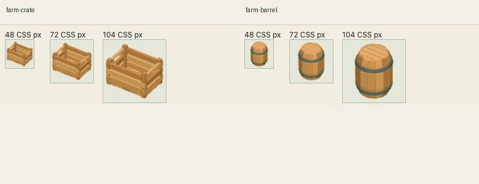
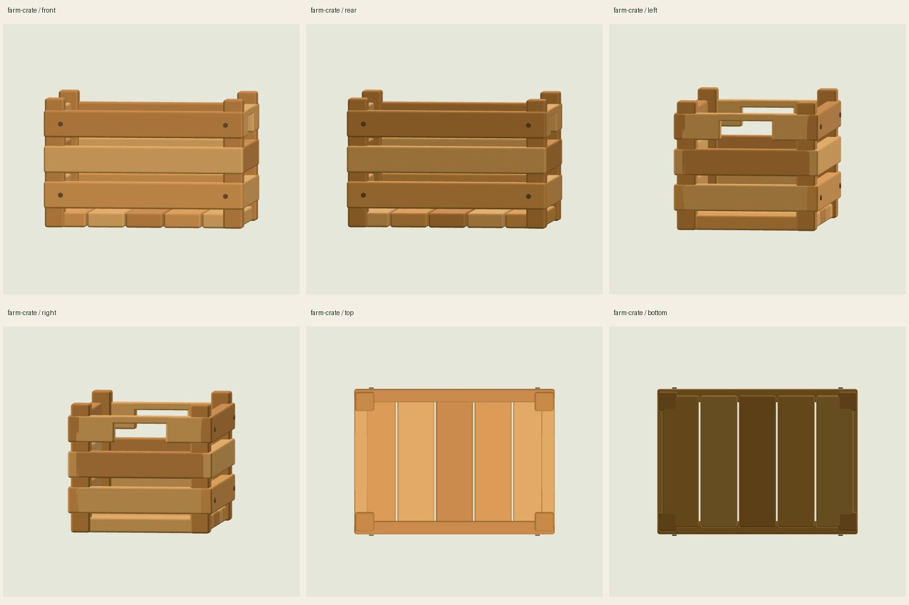
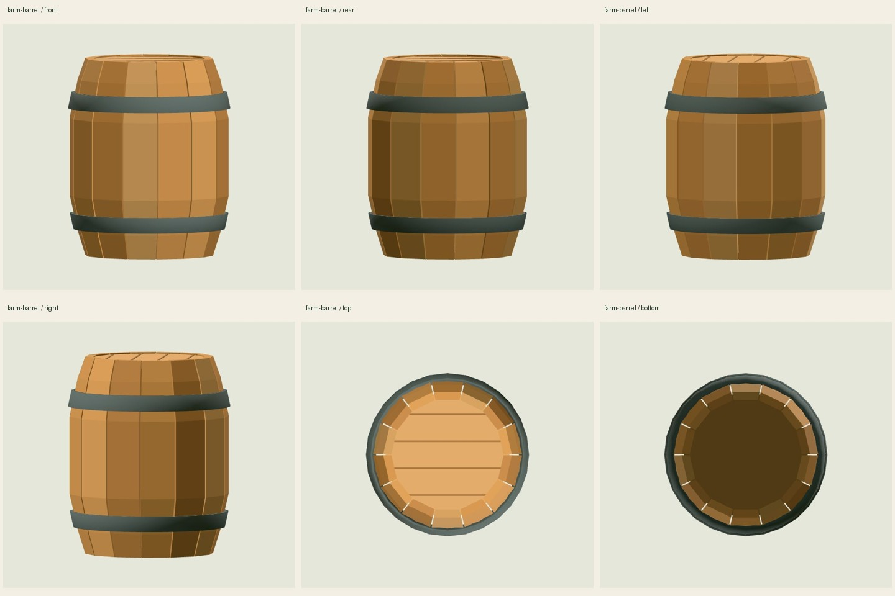
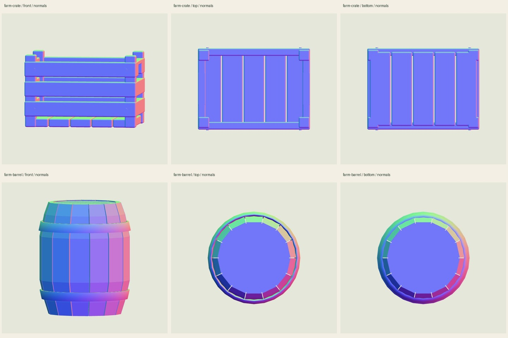

# Ревью моделей тары фермы

**Обе модели визуально готовы для текущего игрового размера, с двумя небольшими геометрическими оговорками ниже.** Проверены шесть ракурсов каждой модели: спереди, сзади, слева, справа, сверху и снизу, на 1180×960 и 390×844. Дополнительно сохранены шесть диагностических кадров нормалей. Все 30 исходных кадров просмотрены отдельно или в контактных листах.



Проверка касается только файлов моделей. Расстановка, игровые камеры, освещение игры и общий бюджет сцены проверяются интегратором. GLB, исходный генератор и общие файлы не изменены. Платных действий, новых моделей, чатов и агентов не было. Npm checks по условию не повторялись.

## Зафиксированные модели

| Модель | Размер | Треугольники | Замкнутые компоненты |
|---|---:|---:|---:|
| farm-crate | 21 120 байт | 2 892 | 33 |
| farm-barrel | 22 076 байт | 1 336 | 22 |

SHA-256:

- `farm-crate.glb`: `409f3b2962716a635b7ec8fc390cae9e8407cb736135969b5428a6d06534668f`
- `farm-barrel.glb`: `64a90611bf94fffd347b027659f49ba7be9939bd70e075beb955b495af101a8b`

Исходные GLB, build.mjs и models.json скопированы в `inputs/` без изменений. Полный список хешей — `manifest.json`; перед передачей все четыре исходных файла по-прежнему совпали с копиями. Хеши кадров — `qa-hashes.json`.

## Осмотр



Ящик читается как открытая деревянная тара: боковые ручки, три ряда досок, цельные стойки и пять планок дна. Щели между планками и открытый верх предусмотрены генератором. Снизу нет пропавших поверхностей; мелкие фаски не дают чрезмерно острых краёв. В миниатюрах 48/72/104 CSS px сохраняются форма и открытый верх; отдельные гвозди на самом малом размере уже несущественны.



Бочка сохраняет характерный выпуклый силуэт, крышку и два контрастных обруча на всех проверенных размерах. В крупном виде сверху и снизу видны узкие радиальные просветы между клёпками. Они соответствуют угловым зазорам в исходном генераторе; это реальная открытая сборка, а не пропавшие треугольники. Крышка и дно закрывают центральную часть. В миниатюрах швы не мешают чтению.

### Небольшие замечания

1. **Бочка: обручи местами не прилегают к плоским граням клёпок.** По лучам на реальной декодированной геометрии максимальный проверенный зазор составляет **0,0059013** единицы. Причина — 28 сегментов обруча вокруг 14 плоских клёпок. На рёбрах обручи пересекаются с деревом, то есть целиком не оторваны. В рассмотренных миниатюрах отделение не видно. Интегратор принял это ограничение для текущего игрового размера и подтвердил, что GLB менять не нужно. Возможная будущая правка: согласовать внутренний контур обруча с многогранным телом или глубже утопить его внутреннюю поверхность.
2. **Ящик: восемь шляпок гвоздей отстоят от досок примерно на 0,002019** единицы. Подтверждено осевыми пересечениями с геометрией. На рассмотренных миниатюрах это не заметно; при крупном предметном просмотре можно слегка утопить шляпки по Z. Модель оставлена без изменений.

## Геометрия и нормали

`audit.mjs` читает замороженные GLB через Meshopt, применяет реальные мировые матрицы и объединяет совпадающие вершины с точностью 1e-5. Для обеих моделей: **0 открытых рёбер, 0 неманифолдных рёбер, 0 противоречий winding, 0 вырожденных треугольников, 0 перевёрнутых нормалей**. Объём каждого связного компонента положителен. Речь о замкнутости отдельных деталей; взаимно пересекающиеся доски и обручи не объединены булевой операцией.

Исходные длины нормалей лежат в пределах 0,99892–1,00129 после квантования; при применении матрицы нормали нормализованы, как в рендерере. Минимальное скалярное произведение геометрической нормали грани и усреднённых нормалей её вершин положительно: 0,9382 у ящика, 0,4777 у бочки. Визуальная диагностика не обнаружила перевёрнутых участков.



Контакт обручей измерен по 720 азимутам на трёх высотах каждого из двух обручей. Пропуски лучей по дереву соответствуют промежуткам между клёпками; по обручам пропусков нет. Это измерение зазоров, не тест столкновений в игре. Для измерения пересечений используются двусторонние треугольники; **в просмотрщике всегда исходное одностороннее отображение GLB**. Геометрический отчёт — `geometry-audit.json`.

## Просмотрщик и воспроизведение

Небольшой изолированный viewer использует проектные three.js и Meshopt, исходные цвета вершин/PBR, нейтральное тональное отображение, фиксированные источники света и ортографические камеры. Поверхность под предметом отсутствует, поэтому ничто не скрывает дно. Материал нормалей переключается отдельным пунктом; обычные снимки сняты с исходным материалом. Загрузка соответствует [официальному GLTFLoader](https://threejs.org/docs/pages/GLTFLoader.html).

Из корня `/Users/gusev/gameios`:

```sh
node assets-src/design-pass/farm-props-shore/storage-props/model-review/audit.mjs
./node_modules/.bin/vite --config assets-src/design-pass/farm-props-shore/storage-props/model-review/vite.config.mjs
```

Открыть `http://127.0.0.1:5206/`, выбрать модель, ракурс и нажать «Показать». Снимки получены обычным `getScreenshot()` встроенного браузера. Основной canvas: 1180×620 на настольном размере и 390×440 на мобильном; три миниатюры имеют 48/72/104 CSS px. Полный размер окна и отчёты сохранены в `qa/desktop.json` и `qa/mobile.json`. Нормали — `qa/normals.json`. Вся геометрия модели рисуется одним вызовом.

Console warning/error: **0**; window errors: **0**; потери WebGL: **нет**. Это результаты отдельного просмотрщика. iPad, FPS, игровые ракурсы и освещение игры здесь не проверялись. Сервер и временная вкладка после ревью закрыты; push выполняет основной чат.
