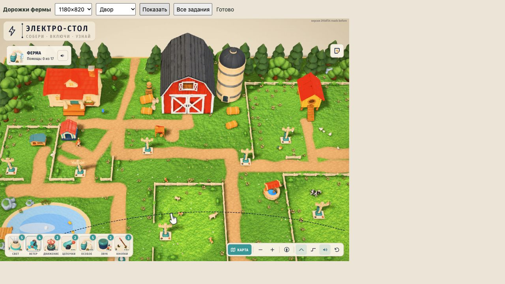
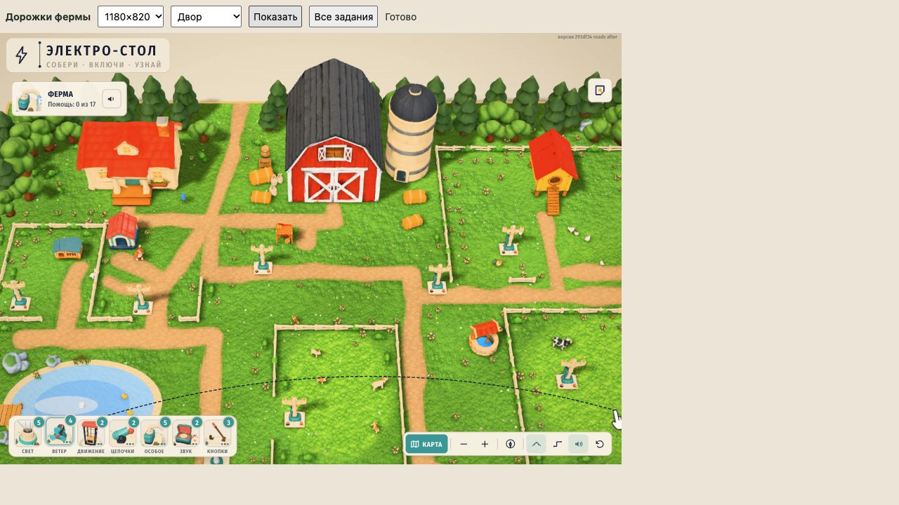
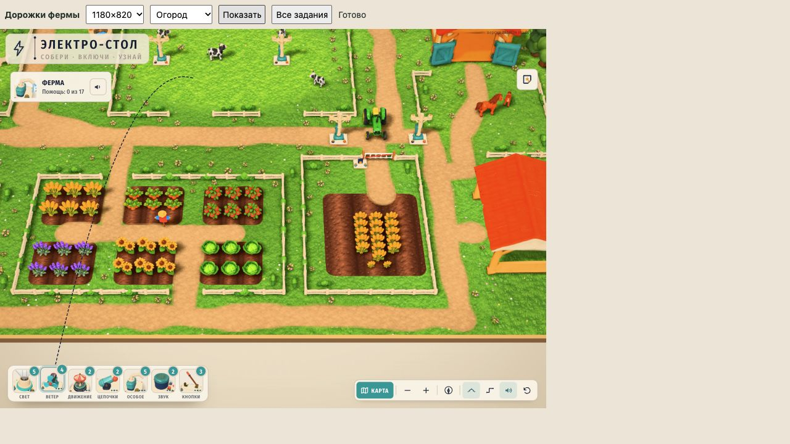
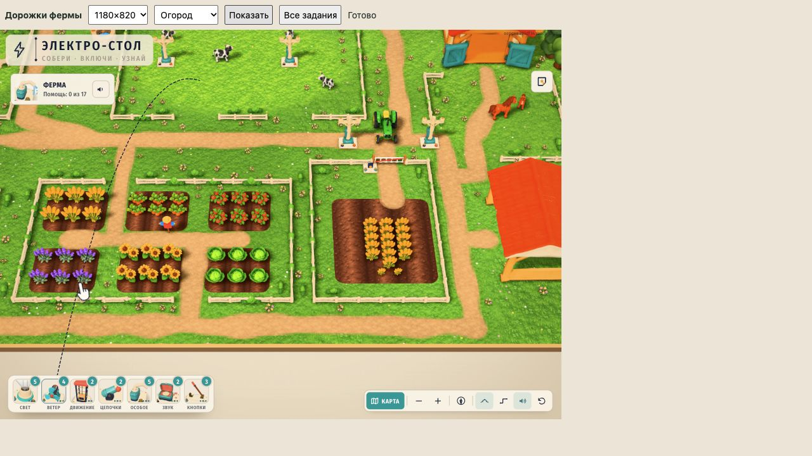

# Более узкие дорожки фермы A

По пункту 3 m0306 и приоритету 1 m0346 изменены только ширины 19 дорожек: с 1,4–2,0 до 1,0–1,4. Главные проходы и подъезды имеют ширину 1,4, короткие пешеходные участки — 1,0, остальные — 1,2. Осевые линии, порядок маршрутов, 686 декоративных объектов и все игровые площадки сохранены.

Данные и статическая проверка — [road-pass](../../farm-v3/road-pass/README.md), коммит e7e6522. Здесь сохранено сравнение настоящей игры до и после. Код ground.ts/farm.ts, тёмная обочина и мягкие рампы маски не менялись. Ширина данных не равна полной видимой полосе с растушёвкой; уменьшение изображения дороги ровно вдвое не заявляется.

| До | После |
|---|---|
|  |  |
|  |  |

## Проверки

Два независимых снимка git-archive 293df34 с закреплёнными public/src. В кандидате заменён только farm-decor.ts на проверенный экспорт. Все остальные исходники совпадают по SHA-256. Используются настоящий запуск карты, материалы, камеры и рендер; игровые данные во время QA не подменяются.

- Сохранены 30 кадров: пять обзорных ракурсов на трёх размерах до и после. Двор, пруд, огород и вход к трактору осмотрены; разрывов или исчезнувших дорожек не обнаружено.
- Проверены все 17 точных камер StoryMap.view на 1180×820, 390×844 и 1024×768 до и после — 102 вида. Координаты камеры, 32 клемм в мире и на экране, геометрия 18 рабочих контуров совпали. Исключены только различающиеся счётчики идентификаторов клемм между сессиями.
- Хеши вершин и индексов всех 212 мешей scenery одинаковы. В восьми batch штатных случайных цветов различается размещение между загрузками; суммарное число 80 сохранено. Пиксельно идентичная сцена не заявляется.
- Статическая проверка подтвердила ровно 19 изменённых токенов width в каждом JSON/TS, одну связную сеть и 789 измерений неуменьшения зазоров. Минимальный зазор ограда–дорога вырос с 0,39844 до 0,637.
- Двенадцать полных кадров Stage.render на q2 дают одинаковые значения до и после: 1 430 795 треугольников без обновления теней/AO, **2 267 987 для сцены с тенями**, 2 858 673 для сцены с AO, **3 695 865 для полного кадра**. Предел 2,6 млн для сцены с тенями соблюдён. FPS не измерялся.
- Console warn/error: 0; runtime errors: 0; потери WebGL нет в обоих снимках. Журналы сохранены.
- npm test: 21/21; typecheck: pass в кандидате. Неизменённый штатный check-farm-decor прошёл до и после в road-pass. Общий decor-validation.json не затронут.

Итог — verification.json; исходные измерения и хеши — qa/*.json и snapshot.json. Проверка не утверждает исправление прежних перекрытий: геометрия авторского декора и игровые камеры сохранены. Полный робот 17/17, настоящий iPad/PWA и оценка рамп шейдера остаются Claude.

## Воспроизведение

Из корня проекта выполнить `python3 assets-src/design-pass/farm-roads/prepare.py`. В двух напечатанных папках запустить `./node_modules/.bin/vite --config qa-vite.config.mjs`. Адреса: `http://127.0.0.1:5194/qa.html` и `http://127.0.0.1:5195/qa.html`. Кнопки выбирают размер, ракурс или запускают 17 игровых камер. verify.py сверяет сохранённые результаты.

При применении проверена неизменность исходных файлов. Авторинг и layout перенесены только после сравнения, runtime выпущен через `build-decor.py --from-authoring`. Все три применённых файла побайтно равны проверенному кандидату. Старый режим генератора без флага сбрасывает поздние ручные правки, поэтому для интеграции не используется.
