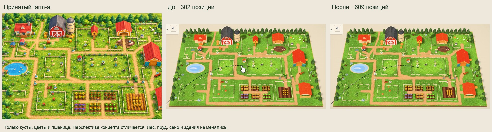
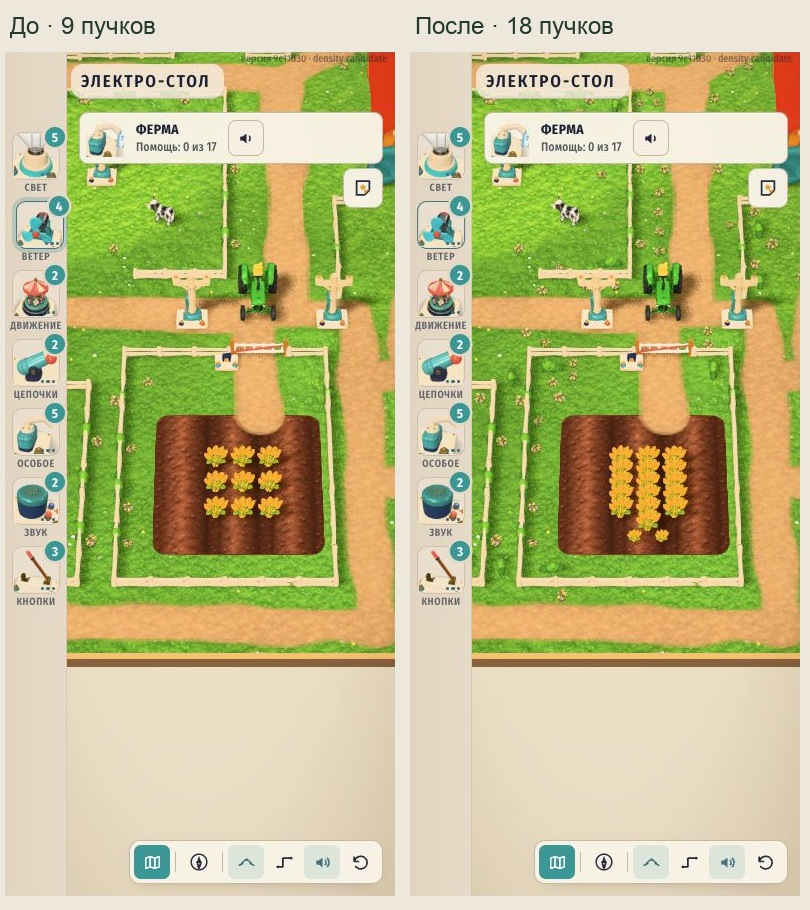

# Плотность фермы A — первый проход

26.10.2026. Применены дополнительные низкие посадки вдоль свободных сторон существующих заборов, у углов загонов и небольшими группами у дорог. Пшеница уплотнена рядами внутри безопасной части поля. Основа — принятый `farm-a.png`, `farm-target-vs-game.png`, действующий авторинг и `DETAIL-AUDIT.md`.

| Группа DECOR | До | После | Добавлено | Треугольников на экземпляр |
|---|---:|---:|---:|---:|
| bush-lite | 96 | 156 | 60 | 794 |
| flower-cluster | 55 | 293 | 238 | 974 |
| crop-wheat, поле | 9 | 18 | 9 | 2942 |
| Все активные записи DECOR | 302 | 609 | 307 | +305930 всего |

Все 302 исходные позиции, fit и yaw сохранены, включая принятые переносы цветов у дома и стога у конюшни. Шесть огородных грядок не менялись. Дороги, 64 участка заборов, SOIL/MUD/MEADOW/PONDS, здания, игрушки, задания, лес, сено и тара не менялись. Неподключённый future-toy слот в авторинге также сохранён. Новых GLB, материалов, текстур и типов моделей нет.

## Размещение и размеры

Новые кусты имеют высоту 0,610–0,708 при ширине 1,426–1,656. Высота новых цветочных групп 0,415–0,525. Группы расположены по существующим линиям оград с отступами, а не случайно по всей траве. У дорог используются короткие пары с длинными свободными промежутками. Повороты и размеры воспроизводимы.

`candidate-audit.json` содержит SHA-256 исходных GLB, декодированные bbox после fit, каждую добавленную позицию, привязку к участку и измеренные просветы. Корпус трактора после игрового fit имеет размер 2,396×2,890×3,8. Дополнительно рассчитана его реальная сглаженная траектория из `updateTractor`, включая поворот после ворот: 8400 состояний за 42 секунды при dt=1/120, 1/60 и 0,05. Новые посадки сохраняют минимум 0,383 единицы до консервативного повёрнутого прямоугольника корпуса. Это дискретный геометрический аудит с запасом, не испытание физической системы на устройстве.

Поле намеренно не засеяно до края: там проходит трактор. Семь новых пучков полного размера продолжают центральные ряды, два меньших завершают южную часть. Заполнить всю площадь как на рисунке без изменения маршрута в этом проходе нельзя.

Минимальные зазоры для новых объектов (единицы карты):

| До чего | Просвет |
|---|---:|
| Край дорожного покрытия | 0,260 |
| Поверхность ограды с полутолщиной 0,08 | 0,162 |
| Резерв рабочей площадки 4×4 | 0,403 |
| Резерв столба радиуса 1,4 | 0,244 |
| Резерв игрушки радиуса 1,15 | 0,246 |
| Консервативный bbox здания | 0,429 |
| Резерв перемещения стада с учётом roam и bbox животного | 0,163 |
| Старый и новый низкий декор | 0,082 |
| Bbox соседних пучков пшеницы | 0,037 |

Все новые позиции дополнительно проходят известные runtime keep/route ограничения. Исходные наложения старого декора не переавторивались. Аудит не обещает отсутствие случайного сближения с предметом, которое позже поставит игрок.

## Реальная игровая проверка

Проверен отдельный снимок **9c11d30b60282b35044686464d5357610902693a** с кандидатом `farm-decor.ts`. `snapshot.json` содержит SHA исходников и проверенной сборки. Общая ветка не переключалась. Изменения соседних чатов через HMR в этот снимок не попадали.

Стенд `review.html` / `qa-runtime.js` загружает настоящую ферму с q1. После построения он приостанавливает update карты для сопоставимых кадров, сохраняя штатный renderer и исходный `dressing()`. Кнопки переключают две группы декора с одинаковыми реальными keep points и маршрутами. Исходная и новая группы используют одни GLB и материалы. Дополнительная невидимая группа только новых экземпляров служит для raycast-аудита. Ни авторские игровые координаты, ни gameplay-файлы этим не меняются.

Сохранены 11 кадров и соответствующие JSON: общий вид, загоны и поле 1180×660; огород/загоны и отдельно поле 390×844. На узком экране большие области дают широкий вид из-за пропорций экрана; читаемость рядов проверена отдельным близким кадром поля. Снимки обёртки имеют 1280×1080, реальный размер iframe указан в каждом JSON. `comparison-*` — обычные компоновки и обрезки этих снимков, без генерации или перерисовки. Перспектива исходного концепта отличается от игровой.

Все 307 новых экземпляров присутствуют после настоящего `dressing()`. В группе декора, включая instanced ограды, получены:

| Runtime-группа | До | После |
|---|---:|---:|
| InstancedMesh batches | 76 | 76 |
| Экземпляры примитивов | 637 | 944 |
| Треугольники по geometry×count | 503771 | 809701 |

Это объём геометрии группы до отсечения камерой и дополнительных проходов теней, **не FPS и не полное число draw calls кадра**. Цветочные группы не отбрасывают тени по штатному правилу; кусты и пшеница сохраняют исходное поведение теней. Рост геометрии требует проверки плавности на iPad.

На каждом сохранённом ракурсе проверены 32 клеммы (по 5 точек) и контуры 18 рабочих кругов (по 12 точек), всего 376 лучей. Новые растения не дали перекрытий ни в одном из 11 наборов. Это проверка новых объектов в выбранных ракурсах, не заявление об отсутствии всех исторических перекрытий при любой камере. Консоль warn/error `[]`, `contextLost=false` во всех записях. В этом прогоне WebGL-сбоя не было.

## Проверки и воспроизведение

- `python3 assets-src/farm-v3/build-decor.py --density-candidate` собирает одинаковый кандидат из сохранённого baseline. Не запускает старую полную перегенерацию и не применяет данные автоматически.
- `node assets-src/farm-v3/density-pass/verify-sync.mjs` проверяет source/layout/authoring, сохранение исходных позиций и всех защищённых массивов, а также сохранённые результаты runtime QA. `-0` и `0` в yaw считаются эквивалентными.
- `prepare-snapshot.py` создаёт временный git-archive проект. В его папке запустить `./node_modules/.bin/vite --config qa-vite.config.mjs`, открыть `http://127.0.0.1:5197/qa.html`. Существующие node_modules используются через symlink; Vite allow list включает реальные пути и шрифты.
- Существующий `scripts/check-farm-decor.mjs` исполнен в снимке. Единственная адаптация — точное ожидание количества пшеницы **9→18**. Остальные проверки дорог, заборов, зданий, поля, шести грядок и игрушек прошли. Отчёт скопирован в `decor-validation.json`.
- `npm test`: 21 тест / 4 файла прошли в снимке и общей рабочей папке. `npm run typecheck`: прошёл в обоих местах. Новые unit-тесты, повторяющие генератор, не добавлялись.

**Claude: обновить устаревшее ожидание `fieldCrops.length === 9` в `scripts/check-farm-decor.mjs` на согласованные 18 либо авторский контракт.** Этот файл находится вне выделенной зоны; поэтому в общей папке он оставлен без изменений и пока выдаст ожидаемый count mismatch. В CI он не вызывается (CI исполняет npm test/build). Это не скрытый пропуск: геометрические проверки реально выполнены в снимке с явно указанной адаптацией.

Итоговые авторинг/layout/src синхронизированы. После визуального прогона emitter был сужен до добавления новых строк, чтобы не переформатировать старый TypeScript; числовой payload совпадает с проверенным снимком. iPad, touch-сценарии, FPS, q2/ночь и PWA в этом проходе не проверялись. Следующий разрешённый объём — отдельное решение по лесу/краю и остальному декору, не часть этого коммита.
