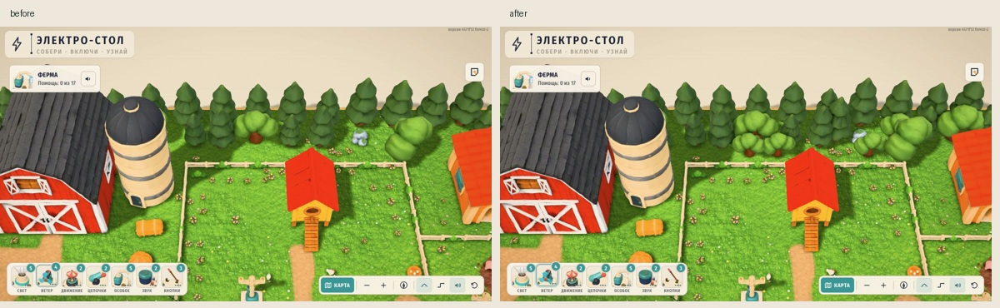
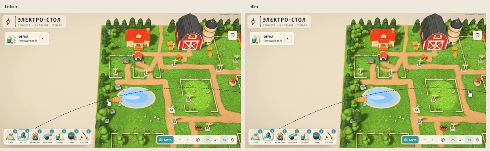
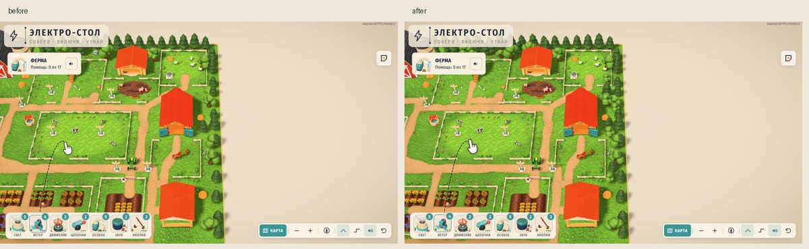
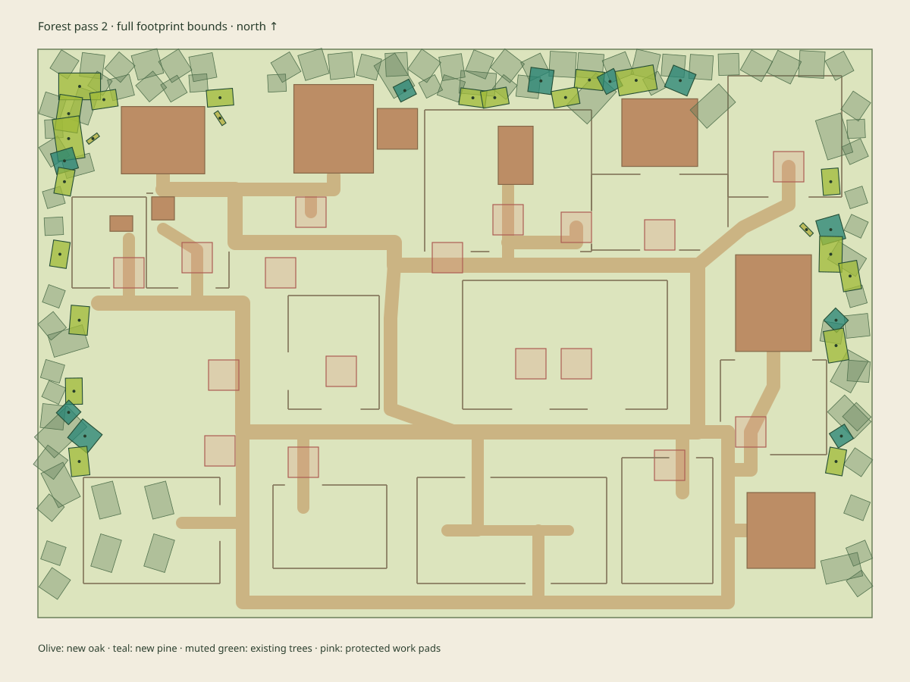

# Второй лесной ряд фермы A

Готов отдельный кандидат: **+20 дубов, +10 елей и +3 куста**. По северу добавлено 13 экземпляров, по западу 11, по востоку 9. Лиственные кроны образуют более низкий второй ряд перед елями. Новые посадки заканчиваются на Z=16,901; передний край не получает новых высоких деревьев.

Все **645 экземпляров baseline сохранены**, включая шесть деталей берега и заменённые три тюка у амбара. Итог кандидата — 678. Изменений shared public/runtime/авторинга нет. Только существующие `tree-oak-lite`, `tree-pine-lite`, `bush-lite`, без новых моделей и заказов.



## Состав и плотность

| Модель | До | Кандидат | Добавлено |
|---|---:|---:|---:|
| tree-oak-lite | 14 | 34 | 20 |
| tree-pine-lite | 66 | 76 | 10 |
| bush-lite | 163 | 166 | 3 |
| Все DECOR | 645 | 678 | 33 |

Лесная часть: север — 8 дубов и 4 ели; запад — 7 дубов и 3 ели; восток — 5 дубов и 3 ели. По одному низкому кусту добавлено в каждой зоне. Дополнительная геометрия — 20 352 треугольника, дополнительных файлов моделей — 0.

Объединение полных границ крон на сетке с шагом0,25 покрывает северную полосу на46,3→54,2%, западную35,98→53,23%, восточную35,68→52,08%. Это оценка проекций габаритов, не пиксельное покрытие кадра; границы полос и метод записаны в `candidate-audit.json`. Дорога на север, ограды и здания оставляют намеренные разрывы.





## Baseline и защитные зоны

Снимок сделан во время интеграции берега и тюков: git4571f12 плюс точные overrides пяти файлов, включая три уже подготовленных GLB. Проверка **всех402 runtime/public файлов** подтверждает побайтное соответствие завершённому коммиту **869bd6cd9852a7384a24da8d5e7a33fe6f6c3975**. Хеши и overrides сохранены в `baseline/manifest.json`; исходная общая папка не обслуживалась сервером QA.

`build.mjs` декодирует реальные GLB с Meshopt, учитывает мировые матрицы, fit, yaw и scale. Проверяются полные повёрнутые границы, а не только центры стволов: край карты, дороги с полной шириной, ограды, рабочие площадки, столбы, игрушки, строения, животные и их зоны движения, маршруты лисы/снаряда/трактора, грядки, грязь и пруд. Для трактора сохранён прежний sweep при трёх dt.

Минимальные непосредственные зазоры новых границ: до дороги **0,278**, до ограды **0,206**, до рабочей площадки **2,312**, до строения **0,368** единицы карты. В `gaps` записан остаток после вычитания обязательных запасов; все значения неотрицательны.

Внутри самого леса кроны намеренно перекрываются: допустимое перекрытие AABB до2,6, расстояние между стволами не меньше max(1,7;0,4×суммы радиусов). Подлесок сохраняет минимум0,4 до центра нового ствола. Это разрешение относится к лесным кронам, а не к игровым защитным зонам.

Полные геометрические данные — `reservations.json`, точные новые позиции/границы/зазоры — `candidate-audit.json`, только добавления для интеграции — **`additions.json`**.



## Реальная сцена, камеры и бюджет

Используется неизменённая игра из снимка, настоящий `dressing()` и `Stage.render()`. Все33добавления проходят штатный фильтр. Группа декора: 81batch до/после, 980→1013 экземпляров примитивов, 827632→847984 треугольника geometry×count. Новые объекты для raycast находятся в отдельной невидимой группе, которая не участвует в рендере.

На1180×660 и390×844 проверены шесть обзорных ракурсов и **все17точных игровых камер**. Для заданий вызывается сама `StoryMap.view(need)`, включая ближайший источник питания и штатные асимметричные отступы. `task-15` — ducksAsk с реальным runtime-якорем. Это камерная QA, не прохождение заданий роботом.

В каждом ракурсе1840лучей: 32клеммы×5точек, все1050вершин настоящих рабочих контуров,18центров и612образцов авторских площадок. **46ракурсов,84640лучей,0новыхперекрытий**. Сохранены58кадров: до/после шести обзорных ракурсов и все17заданий на двух размерах. Снимки фактического окна получены через getScreenshot; исходные JPEG и обзорные компоновки находятся в `qa/`.

Общий кадр1180×820,q2,12полных Stage.render со сбросом renderer.info перед каждым кадром:

| Состояние | До, tri | После, tri | Calls до/после |
|---|---:|---:|---:|
| Без обновления теней/AO | 1 402 567 | 1 422 919 | 577 / 577 |
| Сцена + тени, AO из кэша | 2 218 199 | **2 256 507** | 717 / 717 |
| Сцена + AO, тени из кэша | 2 802 217 | 2 842 921 | 879 / 879 |
| Полный кадр с тенями и AO | 3 617 849 | **3 676 509** | 1019 / 1019 |

Предел2,6M относится к сцене+теням; запас343493tri. ПолныйAO учитывается отдельно; рост58660tri. Это не замер FPS или GPU-времени.

В runtime window errors — 0, потери WebGL нет. В консоли IAB записаны **две одинаковые MutationObserver.observe TypeError без URL**, по одной после загрузок страницы. Поиск в исходниках игры не нашёл MutationObserver; ошибка не попала в window-обработчики сцены. Источник не установлен — это явно сохранённая оговорка, а не заявление о полностью чистой консоли.

## Проверки и передача

- `verify.mjs`: старые645позиций, все не-DECOR данные, авторские якоря и future-slot сохранены; candidate TS/JSON/authoring согласованы; все33добавления проверены.
- Штатный check-farm-decor: pass в изолированном снимке, без изменения проверок —19дорог,64ограды,18растений поля,36растений шести грядок.
- `npm test`:21/21; `npm run typecheck`:pass в том же снимке.
- Все17камер после перехода на точную StoryMap.view проверены повторно и заменили предварительные кадры.

Для интеграции добавлять **только items из additions.json** в соответствующие текущие группы авторинга, затем использовать принятый `build-decor.py --from-authoring`. Не перезаписывать общую сцену целиком старым снимком, если после869bd6c уже добавлена тара или другие детали. Старый default-генератор не запускать.

Воспроизведение из корня репозитория:

```sh
node assets-src/farm-v3/forest-pass-2/build.mjs
python3 assets-src/farm-v3/forest-pass-2/prepare-snapshot.py
cd assets-src/farm-v3/forest-pass-2/.snapshot
./node_modules/.bin/vite --config qa-vite.config.mjs
```

Открыть `http://127.0.0.1:5198/qa.html`. Из корня `node assets-src/farm-v3/forest-pass-2/verify.mjs` проверяет данные и сохранённую QA. `capture-baseline.py` нужен только для сознательного начала нового baseline, не для воспроизведения этого результата. `.snapshot/` игнорируется git и создаётся заново из закреплённого источника.

iPad, FPS, PWA, ночной режим и полный робот остаются интегратору. Push/публикация не выполнялись.
