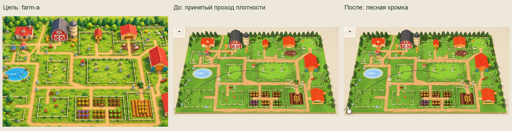
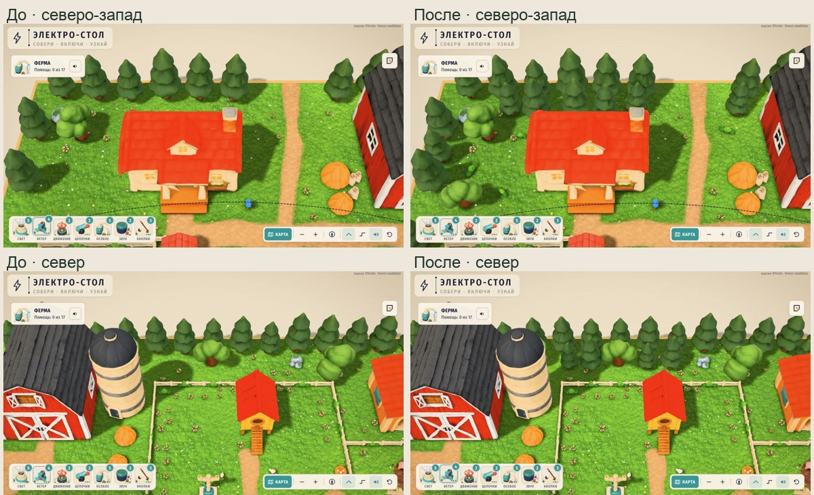
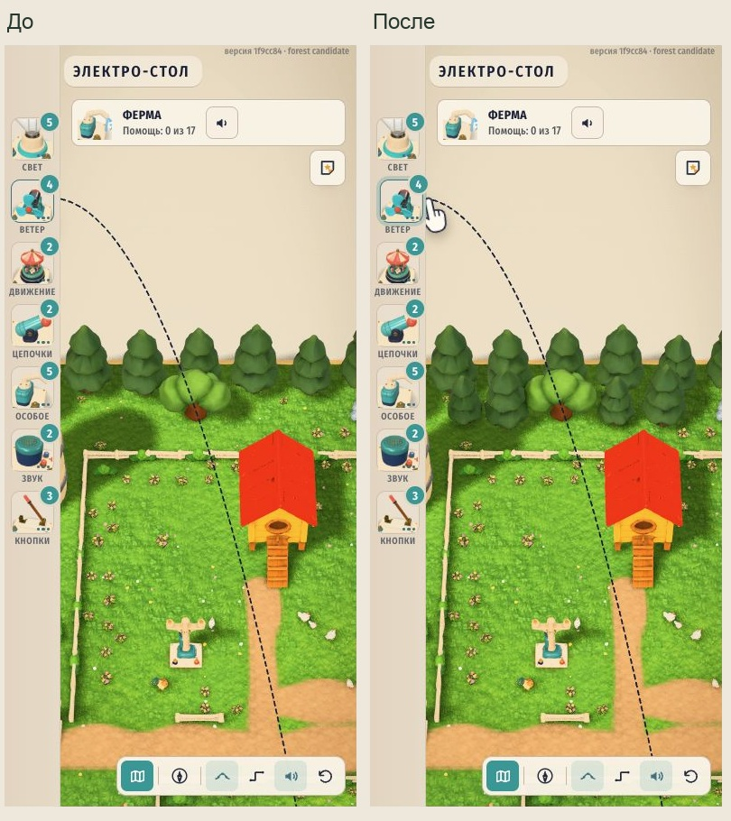

# Лесная кромка фермы A

26.10.2026. Применён конечный проход после принятого `22f0d7e`: второй прерывистый ряд за северными дворами и небольшие продолжения боковых групп. Исходные 609 экземпляров сохранены точно. Передняя кромка остаётся открытой; новые посадки заканчиваются на z=7.786.

| Модель | До | После | Добавлено | Треугольники на экземпляр |
|---|---:|---:|---:|---:|
| tree-pine-lite | 45 | 66 | 21 | 599 |
| tree-oak-lite | 12 | 14 | 2 | 599 |
| bush-lite | 156 | 163 | 7 | 794 |
| Все экземпляры DECOR | 609 | 639 | 30 | — |

Новые группы стоят на севере (11 деревьев и 2 куста), западе (6 деревьев и 4 куста), востоке (6 деревьев и 1 куст). Размеры и повороты варьируются. Дополнительная геометрия — **19 335 треугольников**. Используются только существующие GLB; новых моделей, текстур, заказов и загрузок нет. Не менялись цветы, пшеница, сено, дороги, почва, берега, ограды, игровые точки и runtime-код.

## Границы и сохранение данных

Baseline взят из рабочей папки на `1f9cc847805acb94092fadfa0d47fc326b006cba`, уже включающей `22f0d7e`. SHA256 и существовавшие изменения валидатора записаны в `baseline/manifest.json`. На момент снимка Claude уже исправил ожидание поля на 18 растений; сохранён точный `baseline/check-farm-decor.mjs`, позднее вошедший в `9863c0d`. Этот проход валидатор не редактирует.

`build.mjs` декодирует реальные GLB с Meshopt, учитывает мировые матрицы узлов, fit, yaw и scale. Полная проекция кроны защищена относительно дорог, оград, 4×4 рабочих площадок, столбов, игрушек, строений, мест животных и их маршрутов. Сохранены проверки движения трактора из первого прохода. Минимальный зазор новой полной кроны/куста: до края дороги 1.713, до края ограды 0.132, до рабочей площадки 5.172, до строения 0.400 единицы карты.

Внутри самих лесных групп кроны могут пересекаться: допустимое пересечение их AABB до 1.2 единицы, при отдельном ограничении расстояния между центрами деревьев. Это намеренное соединение крон, не разрешение пересекать игровые зоны. Между центром нового дерева и низким существующим декором оставлен резерв 0.6. Точные позиции, границы и запасы сверх каждого порога — `candidate-audit.json`. Все `gaps` неотрицательны; это запасы после вычитания требуемого просвета, а не всегда непосредственные расстояния между поверхностями.

Все старые items остаются неизменным префиксом групп. `PATHS`, `FENCES`, `SOIL`, `MUD`, `MEADOW`, `PONDS`, прежние параметры авторинга и будущий слот колодца сохранены. Перед применением проверены хеши исходных четырёх файлов и runtime-зависимостей, чтобы не затереть параллельную работу.

## Реальная сцена и бюджет

QA выполнена в изолированном git-archive снимке, с исходным игровым кодом и новым `farm-decor.ts`. Baseline и кандидат переключаются в одной сцене через настоящий `dressing()`; дополнительная невидимая группа используется только для raycast. Все 30 добавлений присутствуют после штатной фильтрации. Группа декора с оградами: 76 batches до и после, 944→974 экземпляра примитивов, 809 701→829 036 треугольников geometry×count.

На общем виде **1180×820, q2** сделаны 12 полных вызовов `Stage.render()`: `renderer.info.autoReset=false`, сброс счётчиков перед каждым кадром. Отдельные состояния соответствуют штатному обновлению теней раз в два кадра и AO раз в три. В каждом состоянии количество вызовов осталось прежним.

| Состояние кадра | До, tri | После, tri | Calls до/после |
|---|---:|---:|---:|
| Без обновления теней и AO | 1 384 636 | 1 403 971 | 572 / 572 |
| С обновлением теней, AO из кэша | 2 188 866 | **2 226 143** | 712 / 712 |
| С обновлением AO, тени из кэша | 2 766 355 | 2 805 025 | 869 / 869 |
| С обновлением теней и AO | 3 570 585 | **3 627 197** | 1009 / 1009 |

Claude в `m0323` уточнил: **предел 2.6 млн относится к сцене с тенями; полный кадр с AO фиксируется отдельно**, и согласовал применение этого кандидата. Запас по согласованной метрике — 373 857 tri. Рост полного кадра — 56 612 tri. Оба исходных замера сохранены в `before-budget-1180.json` и `after-budget-1180.json`. Эти числа не являются FPS, временем GPU или оценкой плавности на iPad. Тени и runtime-настройки не менялись.

## Визуальная проверка и перекрытия

На **1180×660 и 390×844, q2** проверены 23 ракурса на размер: общий, пять участков кромки и все 17 заданий. Мобильный `north` намеренно приближен к группе у курятника; его границы заданы в `qa-runtime.js`. `task-15` в данных — реальное задание `ducksAsk`, чья runtime-точка отличается от старого авторского якоря.

Каждый ракурс проверяет 1840 лучей: 32 клеммы × 5 точек, все 1050 вершин настоящих рабочих контуров, 18 центров рабочих мест и 612 образцов периметров авторских площадок. **84 640 лучей, новых перекрытий 0.** Проверяются именно новые объекты; исторические перекрытия существующими объектами этим результатом не исключаются. `audit-1180.json` и `audit-390.json` содержат полный результат. Потери WebGL и console warn/error отсутствуют.

Сохранены 28 снимков: до/после общего вида и пяти участков кромки на обоих размерах, плюс близкие задания кроликов и овец. Все просмотрены непосредственно или в обзорной компоновке. `comparison-*` и `review-lateral.jpg` — обычные обрезки и компоновки настоящих кадров; исходные PNG сохранены. Перспектива концепта farm-a отличается от игровой. Подсказка руки на кадрах — штатный интерфейс.

## Воспроизведение и ограничения

- `node assets-src/farm-v3/forest-pass/build.mjs` повторяет кандидат из сохранённого baseline. Не применяет его и не запускает старый генератор карты.
- `node assets-src/farm-v3/forest-pass/verify-sync.mjs --candidate` проверяет кандидат; без флага проверяет применённые данные. Проверяются сохранение старых позиций, все защищённые наборы, соответствие source/layout/authoring, SHA моделей, сохранённые QA-данные и бюджет.
- `python3 assets-src/farm-v3/forest-pass/prepare-snapshot.py` создаёт временную папку. В ней запустить `./node_modules/.bin/vite --config qa-vite.config.mjs` и открыть `http://127.0.0.1:5198/qa.html`. Зависимости берутся из существующего node_modules. Общая рабочая папка при QA не обслуживается.
- Штатный `scripts/check-farm-decor.mjs` прошёл в снимке без изменения его проверок: 19 дорог, 64 ограды, 18 пучков поля и 36 растений шести грядок; конфликтов рабочих площадок и зданий нет.
- `npm test`: 21/21, четыре файла. `npm run typecheck`: pass. Проверены и снимок, и общая папка после применения. `git diff --check`: pass.

На момент применения runtime-файлы farm/decor/life/assets/stage/storymap/main/ground совпадали с проверенным baseline. iPad, FPS, ночной режим, PWA и повторное прохождение заданий жестами в этом проходе не проверялись. Публикация и push остаются основному чату / Claude.
