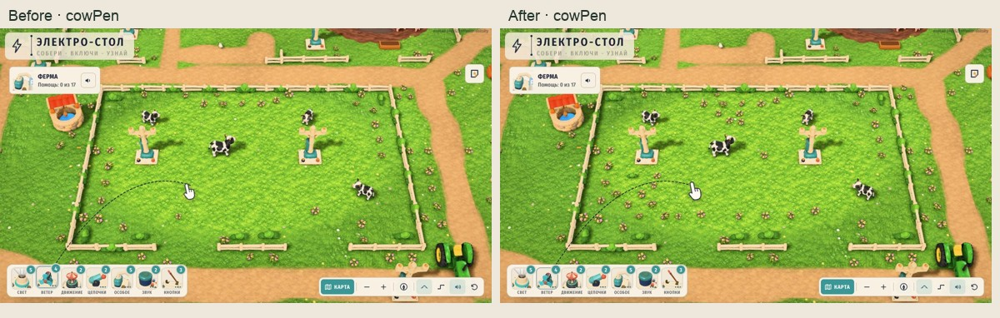
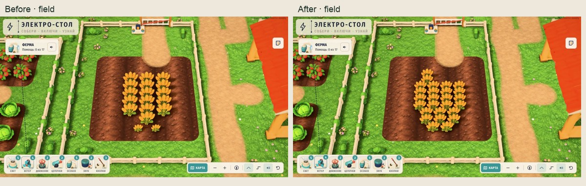
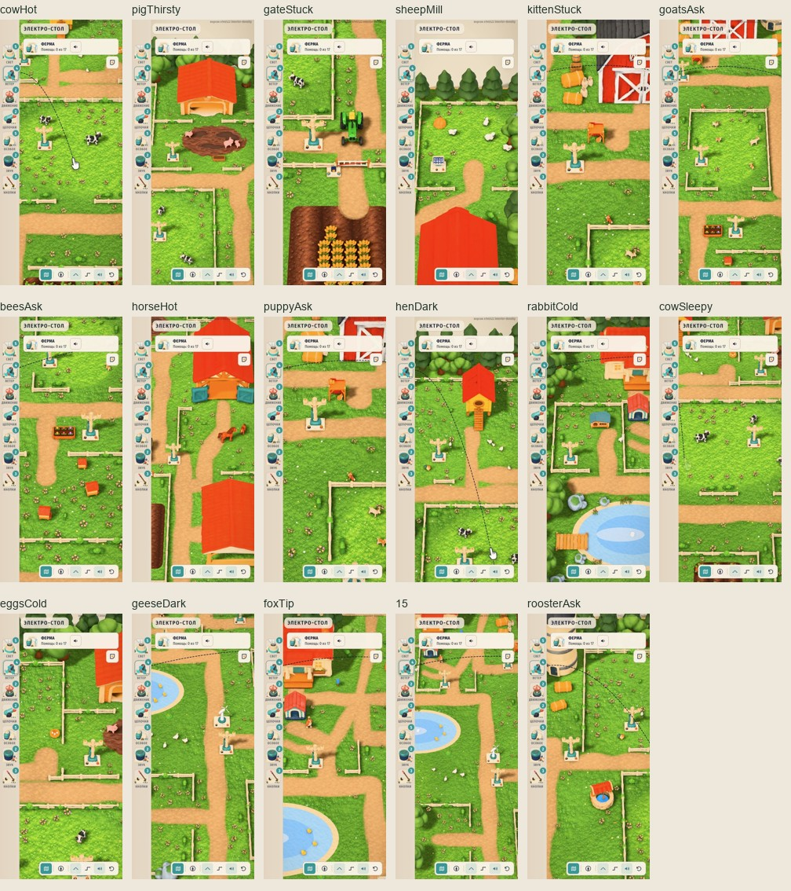

# Цветы внутри загонов и плотные ряды пшеницы

Готово для интеграции: **64 цветочные группы и 5 низких кустов** внутри загонов; отдельная явная замена **18 полевых пучков пшеницы на 26 в 9 рядах**. Итог — **763 экземпляра, net +77**. Существующие 668 неполевых экземпляров, 36 растений шести грядок, ограды, здания, рабочие площадки и игровые якоря сохранены.

Для переноса использовать только **[additions.json](additions.json)** и **[field-wheat-replacement.json](field-wheat-replacement.json)**. Полный candidate — воспроизводимый снимок для QA; он содержит старые, более широкие дороги. Текущие узкие дороги и новые золотые плоские ряды `ground.ts` должен сохранить интегратор.



## Размещение и ограничения

Цветы имеют высоту 0.41–0.49, кусты — около 0.413 единицы карты. Центры новых растений отступают от границ прямоугольников загонов минимум на 2; затем проверяются полные габариты. Это разреженные низкие островки в свободных местах, как на `assets-src/design-pass/variants/farm-a.png`. Крупных растений внутри рабочих зон не добавлено.

| Зона | Цветы | Кусты |
|---|---:|---:|
| Коровы | 17 | 1 |
| Куры | 16 | 1 |
| Пасека | 12 | 1 |
| Сад | 10 | 0 |
| Кролик | 4 | 0 |
| Лошади | 2 | 1 |
| Козы | 1 | 1 |
| Собака | 1 | 0 |
| Овечий холм | 1 | 0 |
| Свиньи | 0 | 0 |
| **Всего** | **64** | **5** |

В свином загоне подходящих точек на проверенной сетке нет: свободное пространство занято резервами движения и задания. У коз, лошадей и собаки число посадок ограничено теми же условиями. Полный inventory и причины отбраковки — в `candidate-audit.json`; это результат дискретного поиска, а не доказательство отсутствия любой возможной точки.

`build.mjs` декодирует GLB с Meshopt, учитывает мировые матрицы, fit, yaw, scale и полные повёрнутые границы примитивов. Сохраняются прежние резервы дорог, оград, площадок, клемм, игрушек, строений, пруда, грязи, грядок, всех старых объектов и штатного фильтра dressing.

Резервы животных усилены: прежние полные зоны roaming сохранены, даже для ныне неподвижных grazers; радиусы учитывают полный корпус. Интерактивные животные используют сферу относительно начала модели с запасом 15% +0.15, включая повороты и кувырок. Добавлены коридоры козлят к карусели, котёнка к точке приземления, пчёл, возвратный треугольник щенка, круг цыплят и полный корпус лисы. Запас для костной анимации консервативный, но не является математическим доказательством всех возможных поз и пользовательских перестановок деталей.

Для трактора проверены полный корпус и сглаженная траектория въезда/круга в течение 42 секунд при dt=1/120,1/60,0.05. Это дискретный swept-body контроль, дополненный прежними непрерывными коридорами. Запасы не уменьшались. Минимальные остаточные зазоры уже после вычитания обязательных резервов: workPad 0.1327, animalRoam 0.0297, actualAnimalBodies 0.0675, runtimeRoute 0.0321, tractorBody 0.1308.

Два цветка удалены после камерной проверки без перестановки остальных: `[13.056,4]` и `[13.074,5.911]`. Первый пересекал один луч к краю площадки из широкого ракурса, второй — два луча из `task-rabbitCold` при 1024×768.

[План габаритов и защитных зон](qa/placement-plan.svg) · [Полные резервы](reservations.json)

## Поле: измеренный прирост и свободный тракторный круг



Пшеница масштаба **0.82**, девять рядов с горизонтальным сдвигом по сужающейся безопасной области. Проверены 96 раскладок: 72 регулярные сетки и 24 варианта со сдвигом отдельных рядов. Между полными AABB оставлен зазор минимум 0.025; используемый шаг — размер модели +0.035.

Сумма площадей полных AABB выросла **20.1512 → 21.1297 (+4.86%)**. Это геометрическая оценка, не пиксельное покрытие и не увеличение на 44% вслед за количеством пучков. Поле имеет площадь 95 единиц². При масштабе 0.82 допустимая область центров на сетке 0.2 занимает около **17.2 единицы²**, в пределах X≈27.1–30.9, Z≈23.9–30.1. При масштабе 1 допустимо около14.84, при0.64 —19.2. Полностью заполнять поле высокими пучками нельзя: внешний круг и въезд нужны трактору.

Два прежних пучка `[29,24.7]` и `[30.5,24.7]` попадали в усиленный резерв полного корпуса при въезде; новая раскладка проходит его. Шесть пучков пшеницы огорода и остальные пять культур огорода не изменены.

Дополнение пустого круга золотыми плоскими рядами в `ground.ts` — отдельная работа Claude (`dbaa34a`); в этот снимок она не входит. Main проверяет объединённую версию с новыми дорогами и грунтом. Его собственные кадры/отчёт: `assets-src/design-pass/farm-interior/`.

## Настоящая игровая сцена и камеры

Снимок закреплён на `e7e6522a7ec154f9226bdab9d432429545afe5c5`, 404 хеша runtime/public, без overrides. Игровой runtime сохранён; подменён только payload `farm-decor.ts`, отдельно подключена QA-обёртка. Источник старых более широких дорог сознательно оставлен консервативным.

Используются настоящий dressing и полный Stage.render. Все **95 новых/заменённых экземпляров** проходят штатный фильтр. В полной группе декора 85→85 batches, 1021→1098 экземпляров примитивов, 858040→947882 треугольника. Дополнительной геометрии **89842**, новых моделей/байтов моделей — 0.

На **1180×660, 1024×768 и 390×844** проверены 7 обзоров и все 17 точных игровых камер. Для заданий вызывается `StoryMap.view(need)` с nearestSource и штатными асимметричными отступами. В каждом ракурсе 2209 лучей: 32 клеммы ×5 точек, 1050 вершин настоящих рабочих контуров, 18 центров, 612 образцов авторских площадок, 369 точек верхней части 41 животного/интерактивного объекта. Проверяются все цели, включая находящиеся вне видимой части кадра.

**72 ракурса, 159048 лучей, 0 новых перекрытий.** Это камерная проверка и геометрические резервы движения, не прохождение заданий роботом. Консоль предупреждений/ошибок пуста, window errors пусты, потери WebGL нет.

Сохранены **95 полных native кадров**: 93 основных и 2 budget. Внутренний viewport игры в iframe имеет точный размер. Метод `getScreenshot` обрезает внешний снимок до720px, поэтому для высоких кадров использован `tab.screenshot({fullPage:false})`; fullPage не применяется. PNG закодированы в JPEG без изменения размера. Размеры и хеши каждого кадра проверены в `qa/screenshot-manifest.json`; весь игровой холст помещается. Контактные листы — отдельные уменьшенные компоновки.



## Бюджет

Общий кадр1180×820,q2; 12 полных Stage.render со сбросом renderer.info перед каждым кадром. Полный AO считается отдельно от принятого лимита сцены+теней.

| Состояние | До, tri | После, tri | Calls до/после |
|---|---:|---:|---:|
| Сцена, AO и тени из кэша | 1430795 | 1520637 | 581 / 581 |
| Сцена + тени | 2267987 | **2385335** | 723 / 723 |
| Сцена + AO | 2858673 | 3038357 | 887 / 887 |
| Полный кадр с тенями и AO | 3695865 | **3903055** | 1029 / 1029 |

Лимит сцены+теней2.6M соблюдён; запас **214665tri**. Прирост сцены+теней117348, полного кадра207190. Замеры не являются оценкой FPS или времени GPU.

## Проверки и применение

`verification.json`: PASS. Все668 неполевых размещений, исходные не-DECOR экспорты, авторские якоря и future-toy сохранены; TS/JSON/authoring совпадают; все остаточные зазоры неотрицательны. `npm test`:21/21; `npm run typecheck`:pass; штатный decor checker:pass.

Единственная адаптация checker сделана **только в изолированном снимке**: hardcoded count18→26. Все остальные проверки оставлены; diff описан в `checker-adaptation.json`. Общий checker принадлежит интегратору.

1. Добавить items из `additions.json` к текущим группам model+fit.
2. Убедиться, что полевая группа совпадает с `before` в `field-wheat-replacement.json`; заменить только её items на `after`.
3. Сохранить текущие PATHS, `ground.ts`, остальные данные и огород. Использовать принятый build-decor с `--from-authoring`; старый генератор по умолчанию не запускать.
4. Согласованно обновить общий validator на26 и проверить объединённую версию. Main уже выполняет эту стадию; этот чат общие файлы не менял.

Воспроизведение из корня репозитория:

```sh
node assets-src/farm-v3/interior-density-pass/build.mjs
python3 assets-src/farm-v3/interior-density-pass/prepare-snapshot.py
cd assets-src/farm-v3/interior-density-pass/.snapshot
./node_modules/.bin/vite --config qa-vite.config.mjs
```

Открыть `http://127.0.0.1:5210/qa.html`. Из корня `node assets-src/farm-v3/interior-density-pass/verify.mjs` проверяет данные и сохранённую QA. `capture-baseline.py` нужен только при сознательном начале нового baseline, не для воспроизведения. Snapshot игнорируется git; исходные модели восстанавливаются из закреплённого коммита.

Проверка на физическом iPad, FPS/PWA и робот относятся к интеграции. Этот чат не выполнял push или публикацию.
