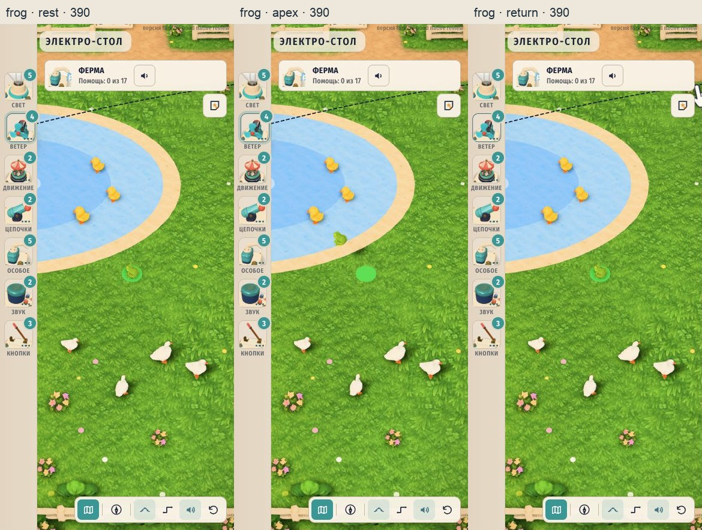
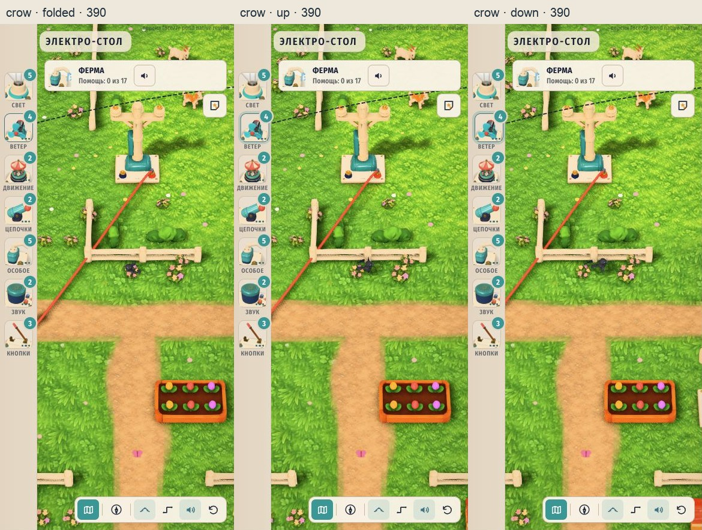
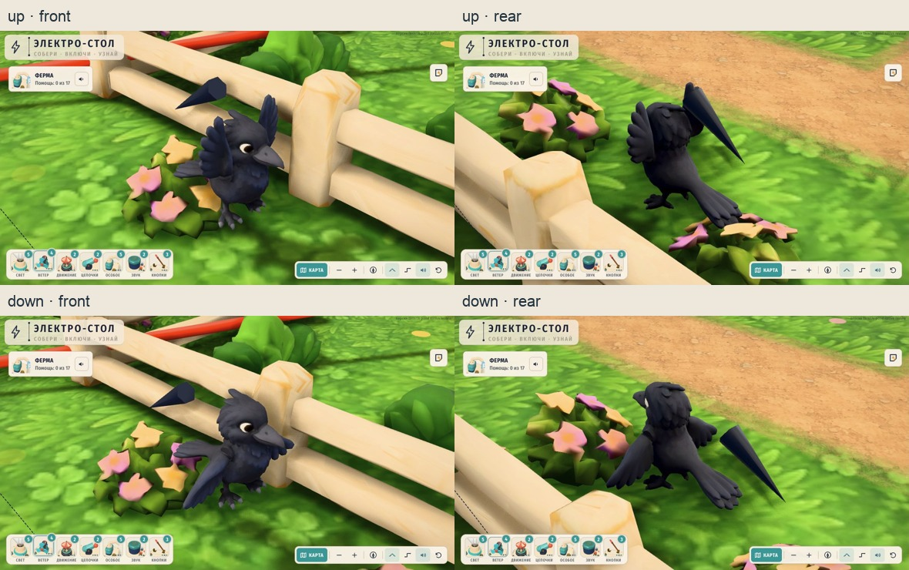

# Повторная проверка интеграции лягушки и вороны

26.10.2026. **Пропущенные мобильные кадры и крупные планы плеч из предыдущей проверки закрыты.** Проверена ревизия `f8ce77eb68abfcfe06cffdb9b50227f8cc18c2c5` в отдельном `git archive`: все 403 исходных файла сверены по SHA-256. Модели, загрузчик, материалы и игровой код не менялись. Результат автоматической проверки — `pass-with-console-note`: геометрия, анимация, снимки и отдельные UI-клики прошли; одна ошибка консоли имеет неустановленный источник.

Сводка — [verification.json](verification.json), точные измерения и оригинальные снимки — [qa/](qa/). Предыдущий [частичный отчёт](../integration-qa/README.md) сохранён как история того прогона.

## Подтверждённые результаты

| Проверка | Результат |
|---|---|
| Игровые фазы | Лягушка rest/apex/return и ворона folded/up/down на 1180×660 и 390×844: 12 полных снимков игрового viewport, качество q2. |
| Плечи вороны | 4 крупных вида: верхний и нижний мах, каждый спереди и сзади. Видимых отверстий с просвечивающим фоном, оторванных шарниров и неподвижных дубликатов крыльев не найдено. На нижнем махе виден небольшой стык закрытых поверхностей. |
| Лягушка: направление и возврат | 480 шагов по 1/120 с; минимум forward·jump = 0.9999999999999999; минимум Y видимой модели 0; возврат точно в стартовую мировую точку, local position (0,0,0), t=-1, модель видима. |
| Лягушка: вершина | При t=0.35 local position (-1.25,1.2,0); модель направлена по прыжку к пруду. |
| Ворона: кинематика | 336 шагов посадки/складывания и 276 шагов бегства. Дрейф плечевых pivots 0 на точности сохранения 10⁻⁶; ошибка зеркальности X 0. Левое крыло X -1.199989…0.799991, правое -0.799991…1.199989. |
| Состав моделей | Ворона: body 3862 + left 528 + right 616 = 5006 треугольников. Хвост входит в body. Неподвижного третьего крыла в GLB нет. Лягушка — 2808 треугольников. |
| Отдельные UI-клики | На 390×844 настоящие pointerdown/up, isTrusted=true, pointerType=mouse: лягушка t -1→0, ворона act sneak→flee. Сработали неизменённые Input/StoryMap и игровой raycast. |
| Проверки кода | В закреплённом снимке 21 тест / 4 файла прошли; tsc --noEmit прошёл. |







Сводные картинки — кропы игровой области из оригиналов, с подписями. Все 18 успешных снимков (12 фаз + 4 плечевых + 2 UI) сохраняют полный viewport игры. Их размеры 1280×1100 и хеши проверяет `verify.mjs`. IAB вернул JPEG-байты; расширения файлов `.jpg`, оригиналы не перекодировались. Отдельно сохранена первая неуспешная попытка UI-клика.

## Метод и происхождение стенда

`review.html` развивает прежний `integration-qa/review.html`: исходный хеш записан в `snapshot.json`, изменения — в `harness-diff.patch`. Хеш версии, использованной для фаз и UI, и хеш финальной версии — в `qa/harness-history.json`. После снимков добавлена только кнопка чтения идентичности пера; успешные фазы не переснимались.

Настоящая игра загружается в iframe с `?q=2`, затем вызывается `startMap('farm', true)`. Только в памяти QA-страницы приостановлен общий `map.update`, отключена речь и задано состояние `map.picked`. Исходные `Life.update/tap` и `Pest.update/tap`, рендер, fit, материалы и свет сохранены. Фазы и числовые циклы запускают `tap` напрямую и шагают время по 1/120 с. Это проверка анимации, не измерение FPS.

Вороне задана управляемая траектория рядом с настоящим проводом, созданным `connect` между существующими столбами. Автоматический случайный `choose` обойдён. Обычные кадры используют штатный `hooks.focus`; четыре плечевых кадра меняют только положение камеры и масштаб. Стенд не создаёт видимой геометрии.

UI проверен отдельно от прямых вызовов: кнопки подготовки сбрасывают/размещают животное и фокусируют камеру, но не вызывают `tap`. Затем выполнен клик по животному на игровом canvas; кнопка результата только читает состояние. События и состояния до/после — в `frog-ui-tap-390.json` и `crow-ui-tap-390.json`. Это мышь в браузере с мобильным размером окна, физический touchscreen не проверялся.

Первая попытка клика по лягушке не попала: после изменения ориентации камера между подготовкой и кликом вернулась к общему виду. Кадр и JSON сохранены как `frog-ui-first-attempt.*`, в успешные результаты они не включены. В закреплённом `src/main.ts:87` есть отложенный на 350 мс `frameParts()` при изменении ориентации; это согласуется с наблюдаемым сдвигом камеры. Повторная подготовка после стабилизации камеры и клик в том же размере прошли.

GLB совпадают с принятыми моделями:

- frog: `380cc5a98dd466dbff9b4ae8a3daccdcb0c8f336934ebfd0e84f21fd396e84cc`;
- crow: `381d8a6f12ef23e58988d5b37dac35760f6644449cad583a4ee5bd7fb095c167`.

Единственное отличие рабочей папки от HEAD на момент закрепления — `scripts/check-farm-decor.mjs`; оно не переносилось в снимок. Все проверки относятся к закреплённой ревизии.

## Тёмный конус возле вороны

Это существующее отдельное падающее перо после испуга. В `src/pest.ts:57` оно создаётся как `ConeGeometry(0.06,0.4,6)`, `tap()` на строке 148 включает его, а блок от строки 205 опускает/раскачивает и позже скрывает. `qa/feather-identity.json` подтверждает идентичность `pest.feather`, родителя scenery и отсутствие этого объекта внутри crow root/sculpt. У него 12 треугольников. Это не оторванная часть GLB и не маркер стенда; изменение модели по этому признаку не требуется.

## Браузер и ограничения

В этом прогоне сохранённые состояния не показывают потери WebGL-контекста, а обработчики ошибок игровой страницы не записали ошибок. В `qa/browser-logs.json` есть одна `MutationObserver.observe TypeError` без URL источника. Её происхождение не установлено; чистая консоль не заявляется и ошибка не приписывается игре или IAB без доказательств.

Чтение полного accessibility-дерева с большим JSON цикла вороны превысило тайм-аут инструмента. После восстановления привязки к той же вкладке чтение конкретного элемента отчёта работало, 3D оставался виден. Этот тайм-аут отличается от прежней потери WebGL-контекста. Длинный JSON лучше читать точечно, а снимки viewport снимать через `screenshot({fullPage:false})` при достаточной высоте внешнего окна.

Не проверены автоматический выбор провода, peck/zapped, полный свободный игровой цикл, настоящий iPad/Safari, физический touch, PWA/offline, FPS и тепловая стабильность. Числовая стабильность шарниров и четыре ракурса не заявляют проверку каждого возможного ракурса. Подтверждённого дефекта интеграции GLB в проверенных состояниях не найдено.

## Воспроизведение

Из корня репозитория с установленными зависимостями:

```sh
python3 assets-src/farm-v3/pond-animals/native-review-2/prepare-snapshot.py
node_modules/.bin/vite assets-src/farm-v3/pond-animals/native-review-2/.snapshot --config assets-src/farm-v3/pond-animals/native-review-2/.snapshot/qa-vite.config.mjs
```

Открыть `http://127.0.0.1:5211/qa.html`, нажать «Загрузить ферму», выбрать размер и фазу. Для плеч включить крупный план и выбрать передний/задний вид; для UI использовать отдельные кнопки подготовки и результата, кликнув между ними по животному. После смены ориентации дождаться стабилизации камеры и заново подготовить кадр.

Проверка сохранённых доказательств: `node assets-src/farm-v3/pond-animals/native-review-2/verify.mjs`. Контактные листы и diff: `python3 assets-src/farm-v3/pond-animals/native-review-2/make-contacts.py` (Pillow, системный Arial на macOS). Папка `.snapshot` игнорируется Git и воспроизводится скриптом. Общая ветка не переключается.
