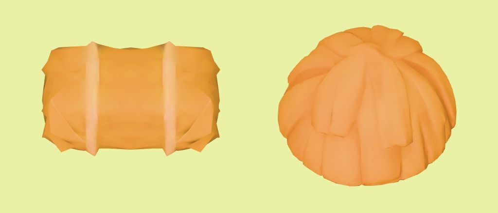
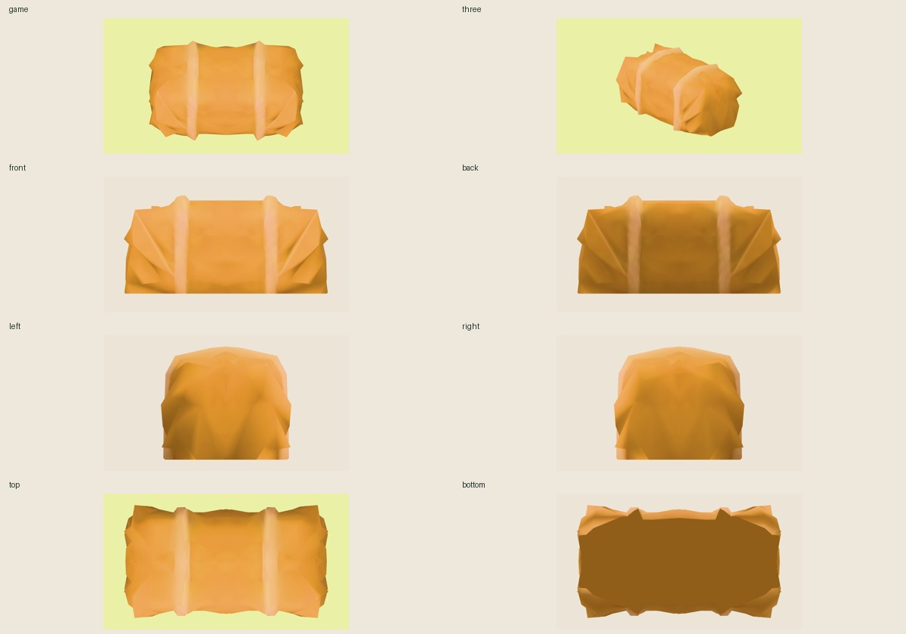

# Отдельный тюк сена из принятого hayloft

Готов к интеграционному ревью: `candidate/hay-bale.glb`, **636 треугольников, 49 592 байта**, один материал и одна исходная текстура WebP 512×512. С игровой камеры видны вытянутый прямоугольный силуэт и две светлые перевязи; старый `haystack` остаётся справа в сравнении.



## Происхождение и способ извлечения

Принятый `public/models/hayloft.glb` — одна связная сетка: два тюка слиты с настилом и задней стенкой. В исходнике нет отдельного объекта, который можно просто перенести. Выбрана открытая передняя правая четверть меньшего тюка, в мировых координатах исходника:

- X: −0,365…−0,230; Y: 1,975…2,218; Z: −0,180…0,080.
- 141 исходный треугольник после срезов; скрытые стороны восстановлены отражением этой части вокруг X=−0,365 и Z=−0,180.
- Отражения запечены в координатах с исправленными порядком вершин и нормалями. Отрицательного масштаба узлов нет.
- Добавлена только плоская нижняя контактная поверхность, цвет которой взят из исходного атласа. Боковые поверхности и перевязи используют исходные UV.
- Исходные материалы и байты текстуры сохранены. Получилась симметричная реконструкция тюка, а не побайтно выделенный исходный объект.

После поворота +90° по Y длинная сторона направлена по X. Центр по X/Z — 0; основание Y=0 с погрешностью декодирования менее 2×10⁻⁹. При `fit.width=2.8` габариты **2,8 × 1,3473 × 1,5492** (X/Y/Z). Исходный стог той же ширины — 2,8 × 1,8396 × 2,8045, 2816 треугольников.

SHA-256 кандидата: `f89caa01a91e7fd8dba0948584bcac1fd3dba52d64a7f92f4a0c08914816c421`.

Исходный hayloft: `b1bd6bda98530cfaee5dd239f85e2b31e65928b8a38dd46c0efb8762394c6791`.

Исходная текстура, совпадает у кандидата: `4931dd901dccb72c3fe52e227ce303c9a1d0391c5947ec0c9c28b90e37b4374b`.

## Проверки

- 15 проверок геометрии/целостности в `qa/validation.json` пройдены: одна связная компонента, 0 граничных/немногообразных рёбер, 0 нарушений порядка граней, 0 вырожденных треугольников, нормали направлены наружу, determinant положительный.
- glTF Validator: 0 ошибок / 0 предупреждений. Для сжатого GLB есть только информационная запись о неподдерживаемом валидатором EXT_meshopt; декодирование проверено NodeIO и браузером. Несжатый GLB проходит без замечаний.
- 14 снимков фактического окна IAB: 1024×768 и 390×844. Восемь сторон кандидата, исходный сеновал и сравнение со старым стогом. WebGL context не потерян, ошибок страницы/консоли нет.
- `npm test`: 21/21; `npm run typecheck`: успешно.



Снимки сделаны через `getScreenshot`. Режим полноразмерного снимка иногда сохранял пустой холст при исправном отображении; такие файлы заменены фактическими снимками окна.

Это изолированная QA ассета с направлением игровой камеры (0,1,0.78). Полная ферма, перекрытия клемм, iPad и FPS требуют проверки при интеграции. Public/runtime/раскладка не менялись; исходные public hayloft/haystack совпадают с сохранёнными SHA. Генерации и платные API не использовались.

## Воспроизведение

Из корня репозитория:

```sh
node assets-src/farm-v3/props-shore/inspect.mjs
node assets-src/farm-v3/props-shore/build.mjs
node assets-src/farm-v3/props-shore/validate.mjs
./node_modules/.bin/vite --config assets-src/farm-v3/props-shore/qa/vite.config.mjs
```

Локальный просмотрщик: `http://127.0.0.1:5198/qa/viewer.html`. Выбрать модель и ракурс, нажать «Показать». «Обновить модель» перечитывает кандидат после сборки. Сервер ограничен этой папкой и node_modules.
